# The Rug Game

A browser version of Stonemaier Games' **Tapestry** with every official expansion: Plans & Ploys, Arts & Architecture, and Fantasies & Futures. You can play it online with a table code, hot-seat on one screen, or solo against the official Automa and Shadow Empire. The table's creator picks the version and expansions. Version means the original 2019 printing or the current official rules.

It is built like the author's other table games, [Fablewood Rummy](https://github.com/lazar-milin/fablewood-rummy) and [Bird Table](https://github.com/lazar-milin/birdcard-ripoff):
- a plain Node.js server with no runtime packages;
- a shared rules engine;
- a Svelte 5 interface built with Vite;
- vector pixel-art in the Cinzel and Atkinson Hyperlegible fonts.

No official Stonemaier artwork, logos or rulebook text are used.

> **Status: in development.** The rules research, the design plan, the main game screen and the art style are approved. The base-game rules engine (M3) is complete, with a test that plays 200 random games to the end. In M4 the table rules and the server API are in: two clients can already play a whole game over HTTP. The turn timer and undo are in too: the host sets a turn timer, the server plays out a timed-out turn, and a player can take back their own choices within their turn. The game screens arrive with M5. Work follows the [issues](https://github.com/serferdinand2/the-rug-game/issues) in milestone order.

## Current interface

The six full capital mat SVGs are examples only. Actual capital mats must be generated from the reusable terrain tiles for each game, following the game setup and the rules-defined plot layout.

The owner-reviewed icons and small pieces from **#5** are available as SVGs in `static/art/`, with matching drawing sources and stable catalog ids. [The release notes](docs/art/issue-5.md) list the approved set and explain the text rendering or later artwork for dice faces, terrain hex markers and game symbols. [The complete review mockup](docs/art/archive/2026-10-23-issue-5/README.md), including its linked capital terrain page, is archived as a frozen reference.

| Resource components using the approved SVGs | Capital composed from terrain tiles |
|---|---|
| 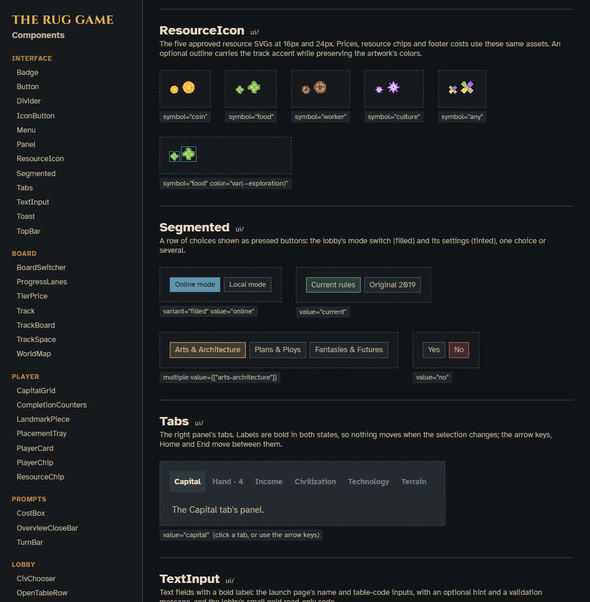 | 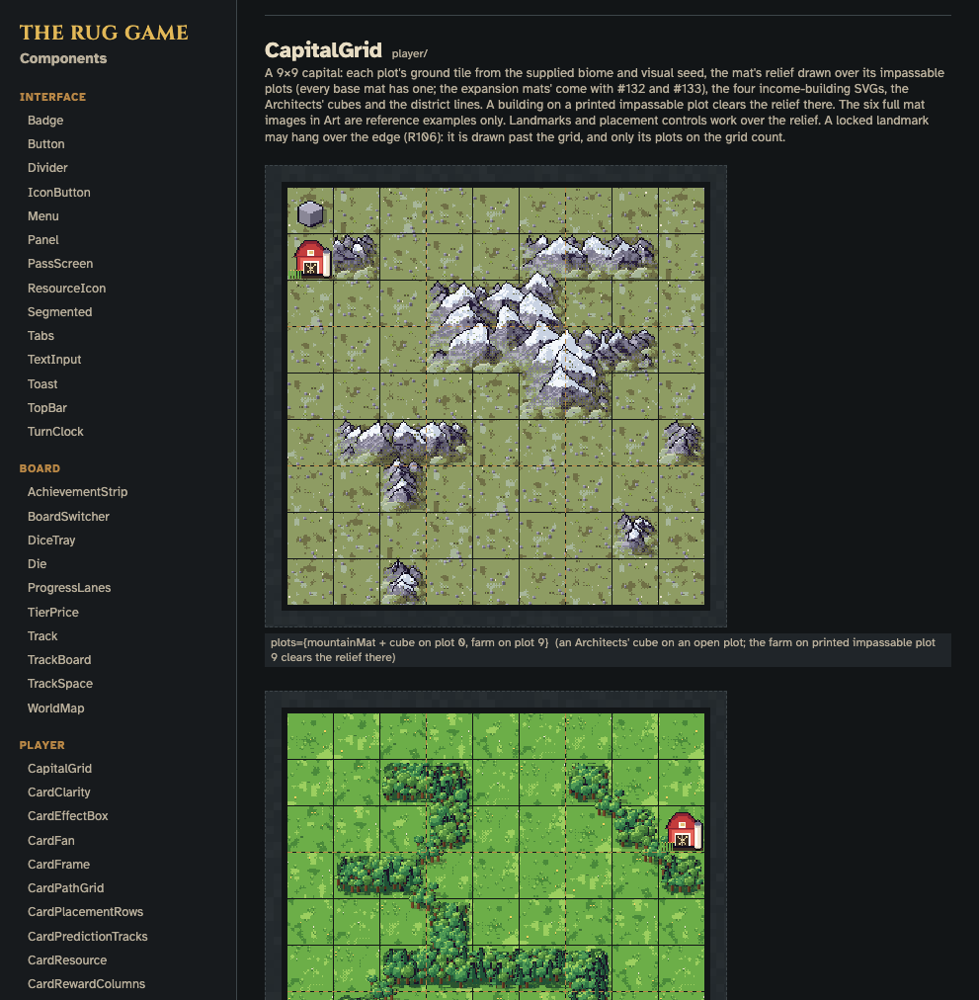 |

The component library now uses the approved resources in prices and chips, income-building SVGs on capital plots, track symbols in headings, and player-color token SVGs on progress lanes. Its Art sections show the complete issue #5 set and explain the three deferred groups. Capital examples compose individual terrain tile SVGs using their supplied biome, visual seed and plot mask; the six full mat SVGs remain example compositions only.

The **phase-one UI/UX handoff for #3** is in [docs/ui/README.md](docs/ui/README.md). It is the manifest for building the real game pages: layout, typography, colours, control states, placement and decision examples, and the remaining designs. The HTML pages are interactive mockups with fixture data; the Svelte application is still a placeholder.

The colours, texture, type, spacing, shadows and motion of these designs are in [src/styles/tokens.css](src/styles/tokens.css), the single source of truth for the look.

Open the references directly or run `node docs/ui/preview.mjs` (port 52990): [Launch](docs/ui/launch.html), [Lobby](docs/ui/lobby.html), [Game](docs/ui/main-screen.html).

| Launch | Lobby |
|---|---|
| 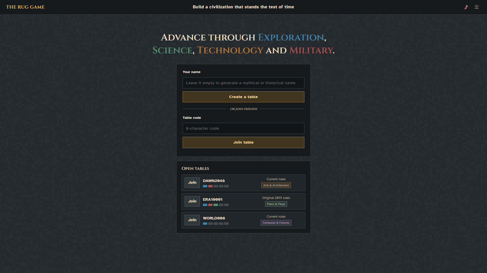 | 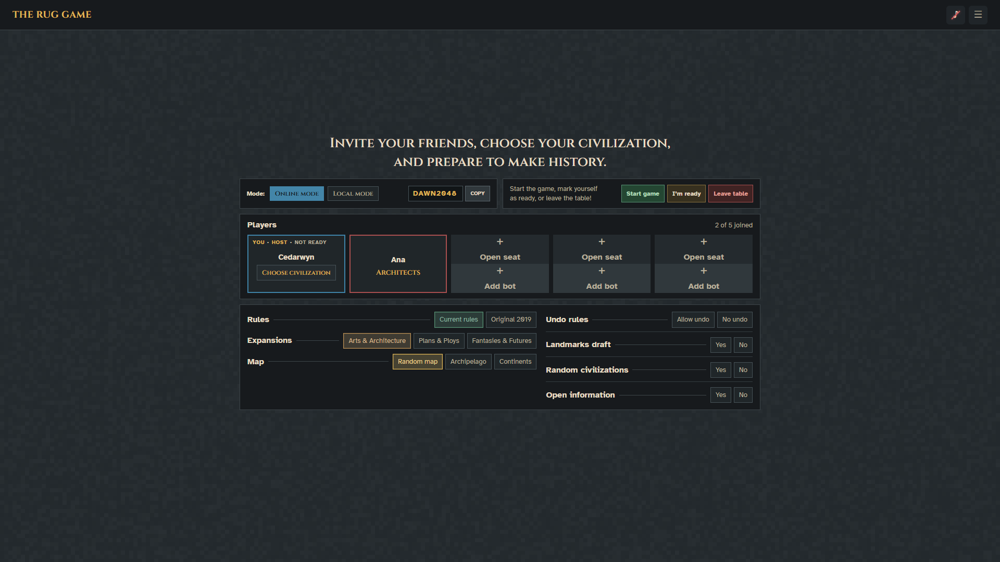 |

**Game: tracks and capital, at the 1920×1080 desktop reference size.**

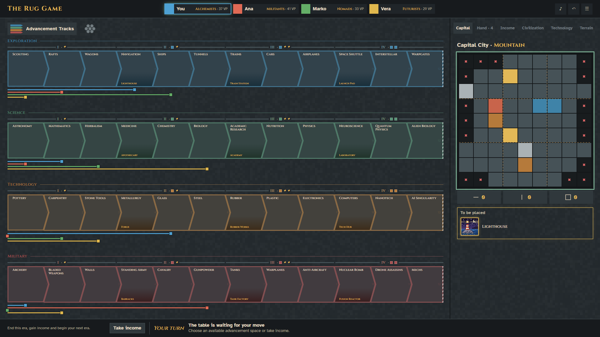

| Player overview | Optional advancement action |
|---|---|
| 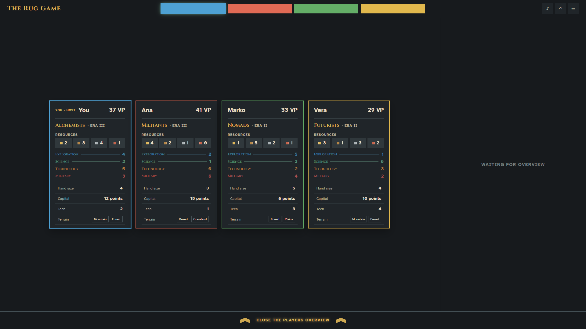 | 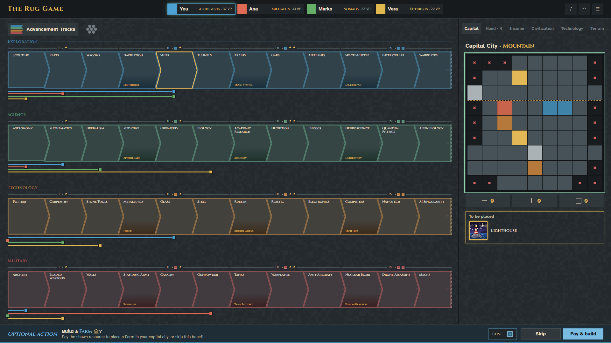 |

**Component library (#48).** Every interface component built from these designs is shown in all its states on the component library page, `/components.html`. Run `npm run dev` and open <http://127.0.0.1:5173/components.html>, or `npm start` and open <http://127.0.0.1:3020/components.html>. The components are indexed in [src/lib/components/README.md](src/lib/components/README.md); several show placeholders until their art lands. The same page shows the art: every scene part, and every asset in the catalog, drawn or still to draw.

| Components | Art |
|---|---|
| 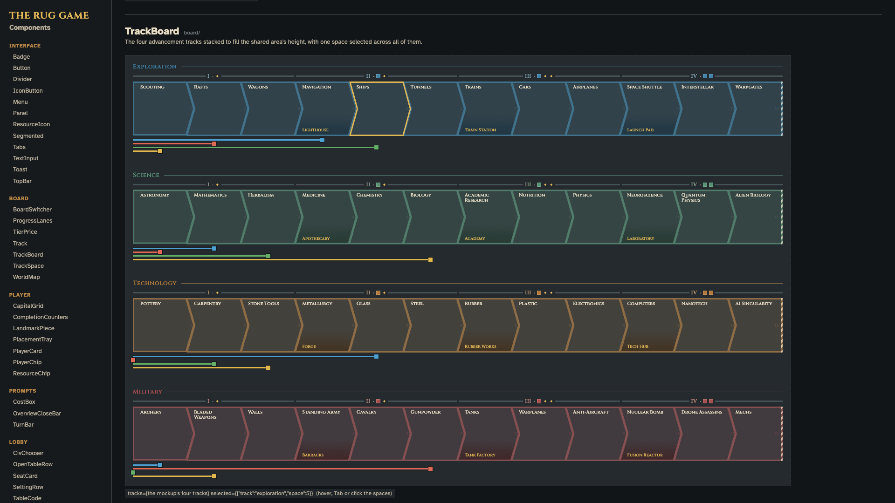 | 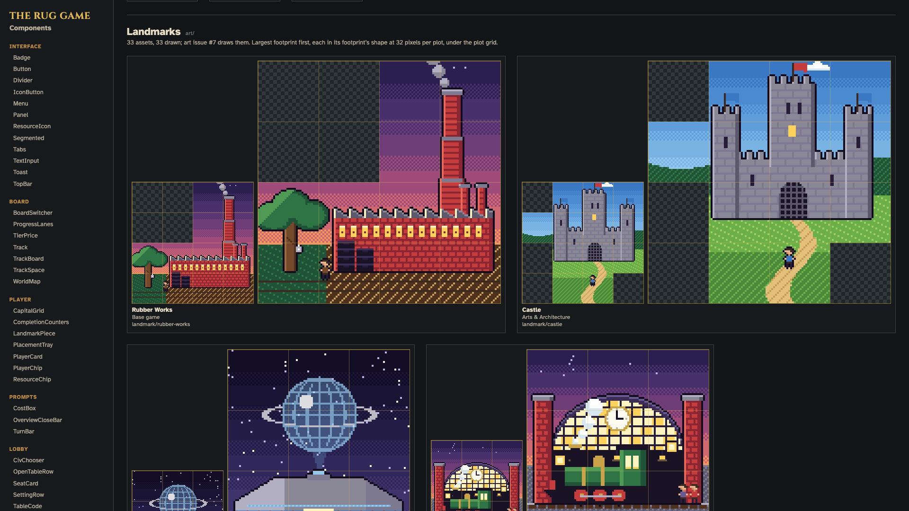 |

**Civilization cards (#47).** The owner chose **Option B · Civilization mat** from [five Collectors card designs](docs/ui/collectors-card-options.html) on 2026-10-23. It is 456 px wide, so it fits the Civilization tab as it is. It shows the portrait beside the rules, the mat's six item spaces, and the score steps; in play, the player's items and score marker take their colour.

| Option B, printed | Option B, in play |
|---|---|
| 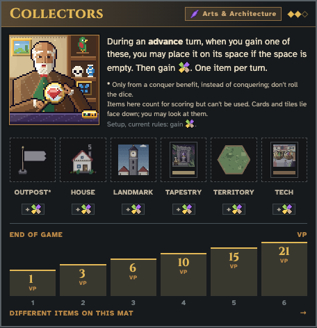 | 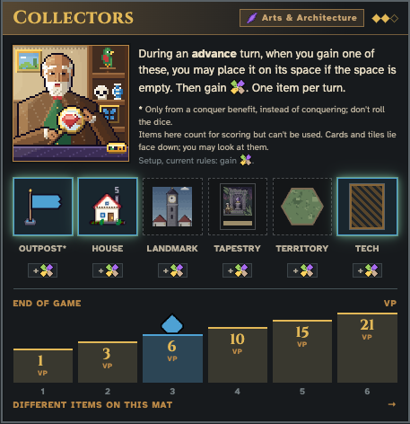 |

The earlier PNG mockups and their HTML/generator are preserved in [docs/ui/archivedpngmockups/](docs/ui/archivedpngmockups/README.md). They are superseded references. Issue #3 remains open for the income sequence, additional decision prompts, results and the other gaps listed in the manifest.

## Run locally

You need Node.js 22.12 or newer. The only packages are development tools (Svelte, Vite, svelte-check, Prettier). The server itself has no runtime packages.

```sh
npm install
npm start      # builds the Svelte client, then serves http://127.0.0.1:3020
npm run dev    # hot-reloading development server on http://127.0.0.1:5173 (the component library is /components.html)
npm test
```

Copy [.env.example](.env.example) to `.env` to change the host or port, or to trust a reverse proxy. For now the app shows a placeholder page; the game screens arrive with milestone M5.

## Deploying

Run a single server process: tables live in its memory. The build needs the development tools, but running the built app doesn't. Behind a reverse proxy, set `TRUST_PROXY=true` in `.env`, or every player shares the proxy's address and its rate limits.

```sh
npm ci                     # install, including the build tools
npm run build              # Vite builds the client into public/
npm prune --omit=dev       # optional: drop the build tools on the host
npm run serve              # serve the existing build (npm start would try to rebuild)
```

Set `HOST=0.0.0.0` when the host requires it, and `TRUST_PROXY=true` behind exactly one reverse proxy (see [.env.example](.env.example)).

## Art style

Every illustration is a 64×64 pixel-art scene in a card frame. This is style C, approved on 2026-10-20.


## Roadmap

The full plan is in [the design document](docs/superpowers/specs/2026-10-20-the-rug-game-design.md). Each milestone is a [GitHub milestone](https://github.com/serferdinand2/the-rug-game/milestones) with a matching `M…` label. Issues list the issues that must close before them under **Relationships → Blocked by**.

| Milestone | What it delivers |
|---|---|
| M0 · Groundwork | Project setup, and the rule conventions for details the research couldn't confirm |
| M1 · Interface design | Approved designs for every screen |
| M2 · Assets | About 300 illustrations and every icon, shown in the component library |
| M3 · Base game rules engine | The complete base-game rules, tested |
| M4 · Tables and server | Tables, the HTTP API, the timer and undo |
| M5 · Playable base game | The full base game online and hot-seat, on desktop |
| M6 · Solo play | The official Automa and Shadow Empire |
| M7–M9 | Plans & Ploys, Arts & Architecture, Fantasies & Futures |
| M10 · Rules pages | In-game help and a card reference |
| M11 · Discord Activity | Playing inside Discord |

## Rules conventions

The research in [docs/research/](docs/research/) left 92 details unconfirmed, marked **[UNVERIFIED]**, plus a list of open questions. Each one has a decision here, so the engine never guesses. These decisions settle [#2](https://github.com/serferdinand2/the-rug-game/issues/2).

- **Rule ids** (R1–R109) are stable. Cite them in code comments and test names, for example `// R16: only explored hexes can be conquered`.
- **Versions.** A table plays either the **Original 2019 printing** or the **Current official rules**. A rule applies to both unless it names one.
- **Sources** are trusted in this order:
  1. the Fantasies & Futures integrated rulebook;
  2. the Plans & Ploys rulebook and the Stonemaier FAQ;
  3. the base rulebook;
  4. the printed components;
  5. Board Game Arena.
- **owner-check** marks base-game decisions the owner will confirm against the physical box. They are tracked in [#45](https://github.com/serferdinand2/the-rug-game/issues/45). Until a decision is confirmed, it stands as written.
- **BGA** marks a former owner-check decision that was checked against the Board Game Arena implementation ([elaskavaia/bga-tapestry](https://github.com/elaskavaia/bga-tapestry): its code, data and component images) instead of the physical box (owner, 2026-10-21). A later look at the box can still correct it, as a data and test change.
- **Left out.** Expansion content that no source shows is left out, never invented. It is listed below and can be added if a source turns up.

### Left out

| Expansion | Left out | What it implies | Rule |
|---|---|---|---|
| Plans & Ploys | 15th tapestry card ("Arc…") | P&P adds 13 tapestry cards instead of 15. With all expansions the deck has 121 cards (50 + 13 + 20 + 38) instead of 123. | R43 |
| Plans & Ploys | Infrastructure Boost (tapestry card) | As above. | R44 |
| Plans & Ploys | Automa civs Iconoclasts and Trailblazers | P&P adds 2 Automa civs (Equalizers, Hucksters) instead of 4. | R46–R47 |
| Plans & Ploys | Fate of Atlantis scenario 4 "The Fall of Atlantis" (the Automa plays Iconoclasts) | Scenarios 1, 2, 3 and 5 can still be played on their own, but the full 5-scenario campaign is not offered. | R46 |
| Arts & Architecture | Polluters (Automa civ) | A&A adds 3 Automa civs instead of 4. | R55 |
| Arts & Architecture | Automa income card for level 4 | Unused anyway because of the next line. | R57 |
| Arts & Architecture | The 10 replacement decision cards (arts position known only on card 4) | No Automa or Shadow Empire games with the arts track. That also sets aside Muses, Connoisseurs, the A&A income cards for levels 1–3, the scoring overlay tile, the Automa's arts benefits and the extra Automa landmark cards at levels 3–4. Without the arts track, the base decision cards are used and Influencers stays available. | R59 |
| Arts & Architecture | Replacement Hucksters/Trailblazers card | The P&P Hucksters text is used. | R60 |
| Revised Civilization Pack | The whole accessory (31 revised civ mats, 2 revised capital mats) | Out of scope; both versions use the original mats. | R101–R104 |

### Decisions by area

<details>
<summary><b>Base game: setup and components</b> (5 rules)</summary>

| Rule | Question | Decision | Basis | Check |
|---|---|---|---|---|
| R1 | Capital mats 1–6: impassable plots and names? | Use the 01 §6.2 grids. Names: 1 Mountain, 2 Wetland, 3 Tropical, 4 Desert, 5 Grassland, 6 Forest. Each mat has 22 impassable and 59 buildable plots. Same mats in both versions. | 01 §6.2 (BGA grids checked against the mat art) / 02 §6.1, §6.2, 02 OQ1. Mat 1 matches 02's separate reading of the rulebook photo cell for cell. | BGA |
| R2 | Large map (4–5 players): layout? | A radius-4 hexagon of 61 hexes. 25 are pre-printed (the middle island plus 6 start regions of 4 hexes) and 36 are unexplored. Terrains and starts 1–6 as in 01 §2.3 and Appendix A. | 01 §2.3, App. A (BGA; column counts checked against the art) / 02 §7.3, 02 OQ3 | BGA |
| R3 | Small map (1–3 players): layout? | A radius-3 hexagon minus `0_-3`, `-3_0` and `3_3`, giving 34 hexes: 13 pre-printed, 21 unexplored. Data as in 01 App. A. The BGA axial coordinates are the engine's map model. | 01 §2.3, 01 OQ9 / 02 §7.3. BGA and the myautoma app each give 34 hexes with 13 pre-printed. | BGA |
| R4 | The 48 territory tiles? | Use 01 App. B (ids 1–48, 6 corner terrains each). Benefits: 8 each of coin, worker, food and culture; 4 tapestry card; 3 invent; 2 research with X; 2 "gain 2 tiles"; 1 each of farm, house, market, armory and upgrade. | 01 §7.1, App. B (BGA; benefit counts spot-checked against the tile art) / 02 §7.1, 02 OQ2 | BGA |
| R5 | The 15 space tiles? | Use the 01 §7.2 list. Tile 11 is "conquer, then 1 VP per territory you control" (official erratum) in both versions. The 3 tiles readable in the BGG photo are tiles 13, 15 and 5. | 01 §7.2 (art matches BGA) / 02 §7.2 (2 flags), 02 OQ2 | BGA |

</details>

<details>
<summary><b>Base game: tracks and dice</b> (6 rules)</summary>

| Rule | Question | Decision | Basis | Check |
|---|---|---|---|---|
| R6 | Science die (d12) faces? | Each of the 4 track icons is on exactly 3 faces, so each track has a 1/4 chance. | 01 §1.1, 01 OQ1. BGA uses 4 equally likely outcomes. | BGA |
| R7 | Red conquer die faces? | 4 VP, 5 VP, 6 VP, 7 VP, and "1 VP per territory you control" on 2 faces. | 01 §1.1, 01 OQ2. The 5 face types come from the art; the duplicate comes from BGA. | BGA |
| R8 | Black conquer die faces? | 1 coin, 1 worker, 1 food, 1 culture, and "?" on 2 faces. "?" gives the benefit printed on the conquered territory tile; a pre-printed hex gives nothing. | 01 §1.1, 01 OQ2 (the duplicate comes from BGA) | BGA |
| R9 | One move jumps over a tier's first space (e.g. Socialism). Which landmarks are gained? | Every still-available landmark of each tier II/III/IV whose first space (4, 7 or 10) the forward move reaches or passes, lowest tier first. The exceptions are effects that say "no landmarks" (Futurists, Tinkerers option 4). Regressing and placing a token never gain landmarks. | 02 OQ9. The rulebook says "advance into a tier by any means", and Tinkerers' printed "no landmarks for tiers you pass" implies the default. Rejected: landmark only when landing exactly on space 4, 7 or 10. | |
| R105 | Interstellar Travel (exploration 11): which space tile may "explore 1 of them" use? | One of the 3 space tiles this benefit just gained. Older space tiles in your supply wait for Warpgates or another explore. If the stack holds fewer than 3, you choose from those you gained; if you gained none, nothing is explored. | 01 §3.2 (F&F Track Reference: "Gain 3 space tiles, then explore 1 of them"). Warpgates and Navigation word theirs differently ("from your supply", "then explore"). No official ruling. Rejected: BGA's any unexplored tile in hand. Owner, 2026-10-24 ([#52](https://github.com/serferdinand2/the-rug-game/issues/52)). | |
| R109 | Alien Biology (science 12): does a roll on a track whose token AI Singularity took off score 5 VP? | Yes. The track counts as complete, with the token treated as still on space 12 (FAQ #9), so the roll "would push you off a track". | 01 §3.3 (Alien Biology), 01 §3.4 (AI Singularity: the technology track "still counts as complete"), 01 §12 FAQ #9; no official ruling on this case. Owner, 2026-10-26 ([#54](https://github.com/serferdinand2/the-rug-game/issues/54)). | |

</details>

<details>
<summary><b>Base game: income turns, scoring and game end (incl. tiebreakers)</b> (4 rules)</summary>

| Rule | Question | Decision | Basis | Check |
|---|---|---|---|---|
| R10 | Tiebreaker chain, Original 2019 printing? | 1) Most VP. 2) Most resources left (coin + worker + food + culture). 3) Shared victory. | 01 §11 [RB]; BGA still uses this rule. | |
| R11 | Tiebreaker chain, Current official rules? | 1) Most VP. 2) Tallest landmark in your capital city, using the ranking below; a player with none there loses to anyone who has one. 3) Most resources left. 4) Shared victory. | 01 §11, 01 OQ3 / 03 §1.2, FF.2.7 ([PP][FF][SM-FAQ]; Mike Young on City in a Bottle). Step 3 reuses the replaced official rule. Rejected: shared victory straight after step 2. | |
| R12 | How is "tallest landmark" measured digitally? | A fixed height rank (1 = tallest), listed under this table. Each landmark exists only once, so step 2 of R11 can stay tied only when none of the tied players has a landmark in the city. | 01 §11 / 02 §5 / 03 §1.2, 03 OQ P&P9. Official statements: Fusion Reactor is tallest; Skyscraper > Holocenter; Digital Studio > TV Station. The tall/medium classes come from the myautoma app. BGA can't confirm it: it breaks ties by resources only and has no height data. | owner-check |
| R13 | Which landmarks are "in your capital city" for the tiebreak? | Only landmarks whose footprint covers at least 1 plot of the capital mat's grid. These do not count: landmarks beside the mat, set aside (City in a Bottle), on a tech card, tapestry card or civ mat, or on the map (Nomads). | 03 §2 icon checks (BGG-2788569: landmarks on tapestry cards don't count) / FF.6 2.1 (City in a Bottle always loses ties) | |

**Digital height ranking (R11–R13)**, 1 = tallest:

1 Fusion Reactor · 2 Skyscraper (P&P) · 3 Holocenter (A&A) · 4 Launch Pad · 5 Laboratory · 6 Tech Hub · 7 Lighthouse · 8 Forge · 9 Train Station · 10 Academy · 11 Rubber Works · 12 Tank Factory · 13 Apothecary · 14 Barracks · 15 Castle (A&A) · 16 Barn · 17 Bridge (A&A) · 18 Library · 19 Stadium (P&P) · 20 Digital Studio (P&P) · 21 TV Station (P&P) · 22 Urban Farm (P&P) · 23 Villa (A&A) · 24 Birdwatching Perch (A&A) · 25 Com Tower · 26 Game Store (P&P) · 27 Windmill (A&A) · 28 Opera House (A&A) · 29 Bakery · 30 Clock Tower (A&A) · 31 Monolith (P&P) · 32 Stock Market · 33 Treasury.

How the ranking was built:
- **Ranks 1–3:** the official statements. Skyscraper and Holocenter were only ever compared with the Fusion Reactor.
- **Ranks 4–8 and 9–14:** the "tall" and "medium" classes. Within a class, the higher tier comes first, then track order (Exploration, Science, Technology, Military).
- **Ranks 15–33:** landmarks with no height data, sorted by footprint size (largest first), then by name. Digital Studio sits directly above TV Station, per the official statement.
- **Owner-check:** measure the 18 base miniatures, then reassign the 18 base slots (1, 4–14, 16, 18, 25, 29, 32, 33) in measured order.

</details>

<details>
<summary><b>Base game: capital city and landmarks</b> (3 rules)</summary>

| Rule | Question | Decision | Basis | Check |
|---|---|---|---|---|
| R14 | Must an overhanging landmark cover a grid plot? | Yes. A landmark is aligned to the grid, sits only on open plots and covers at least 1 grid plot. Mats that forbid overhang (e.g. Mesa) are stricter. It goes beside the mat, still yours, only if no such spot exists. Placement is mandatory when possible. | 01 §6.1, 01 OQ5 (BGA rule; official overflow and must-place rulings) | |
| R15 | May landmark footprints be rotated or mirrored? | All 4 rotations (0°, 90°, 180°, 270°) are legal; mirrored footprints are not. This applies to every landmark, in both versions. | 01 §6.1, 01 OQ5 / 02 §5 / 03 §1.6, 03 OQ P&P7. BGA allows rotation; a miniature can be turned but not mirrored. | |
| R106 | May two landmarks overlap off the grid? | No. A landmark may not cover a plot off the grid that another landmark's overhang already covers, just as two miniatures can't stand in the same spot. | 01 §6.1 / R14 ('sits only on open plots'), read physically; no official text. Owner, 2026-10-24 (#16 design). | |

</details>

<details>
<summary><b>Base game: map, exploring and conquering</b> (4 rules)</summary>

| Rule | Question | Decision | Basis | Check |
|---|---|---|---|---|
| R16 | Can you conquer an unexplored hex? | No. "Territory" always means an explored hex (a tile or pre-printed terrain). A conquer target must be explored, on top of the usual conditions. Only effects that explicitly explore first (e.g. Automa Conquer Neutral) put outposts on unexplored hexes. | 01 §7.3, 01 OQ4. BGA allows only explored hexes. | |
| R17 | Tanks: do you get both dice if your conquest is trapped? | Yes. "Was controlled by an opponent" is judged when you declare the conquer, and the dice are rolled even when trapped. | 01 OQ10; F&F FAQ (you always roll when trapped). Rejected: one die after a trap. | |
| R107 | Black die '?' after a trapped conquest? | It still gives the benefit printed on that territory tile; a printed territory gives nothing, as R8. | 01 §7.3 / R8; the rules don't say. BGA gives the tile's benefit after a trap. | BGA |
| R108 | May a finished player still respond to a conquer? | Current rules: no (the A&A amendment, FAQ #18). Original 2019 rules: yes, since the amendment came later; a sprung trap still keeps control and topples the attacker, but its resource isn't gained, because a finished player gains nothing (01 §4.3). | 01 §4.3, §9.3; owner, 2026-10-24 (#17 design). | |

</details>

<details>
<summary><b>Base game: tech cards, tapestry cards and achievements</b> (10 rules)</summary>

| Rule | Question | Decision | Basis | Check |
|---|---|---|---|---|
| R18 | Where are the income-mat innovations that landmark tech cards need? | Currency = market row space 2; Banking = market 3; Farming = farm 2; Breeding = farm 3; Writing = house 3; Telephone = house 4. The prerequisite is met while that space has no building on it, for you or either neighbour. | 02 §4, 02 OQ13 / 01 §5 (income-mat art) | BGA |
| R19 | Can tech-card benefit chains loop (Assembly Line, Electronics, Nanotechnology, Lithium-Ion Battery)? | No extra rule is needed: a card's circle or square always targets the other row, so never itself. The engine enforces "same track space once per turn" and "each repeat icon once per turn" in both versions. Without these limits the 2019 rules allow endless loops. | 02 OQ11 / 01 §12 #5–6 (A&A amendment, F&F FAQ) | |
| R20 | Is there a tapestry hand limit? | No, in both versions. Advisors' discard-to-4 is a civ ability, not a general limit. | 01 §9.1, 01 OQ6; no rulebook states a limit. | |
| R21 | Trap used as a response: does the trapper gain a resource? | Yes. Discard the Trap: you gain 1 any resource, keep control and topple the attacker's outpost. The attacker still rolls and gains 1 die result. | 01 §9.3 (BGA card text) and 02 §3 (BGG wiki) agree; 01 OQ7. | BGA |
| R22 | Trap played as a tapestry card? | WHEN PLAYED: gain 10 VP. | 01 §9.3 / 02 §3, 01 OQ7 | BGA |
| R23 | When are achievement VP gained? | Immediately, when your token goes on the highest free box, including on an opponent's turn. | 01 §10, 01 OQ8; BGA; Political Posturing says "place … and gain those VP". | |
| R24 | Achievement VP boxes on each board side? | 4–5 players: complete a track 15/10/5; topple two outposts 15/10/5; middle island 10/5. 1–3 players: 10/5 for each of the three. | 01 §10 (board art) / 02 §8, 02 OQ4. The strategy article's maximums (40 and 30) match. | BGA |
| R25 | Tapestry cards played in step 1 of an income turn, and after era 4? | **IT2–4:** a card played in step 1 goes into the new era's empty slot, and the normal step-2 card is then played on top of it. "First of your neighbours" is still checked in step 2. **Era 1:** an "on top of your current tapestry" effect does nothing. **In or after IT5:** Current: the card goes onto the era-4 stack. Original 2019: no card may be played. | 03 OQ FFr6, FF.2.2 / 01 §9.2, §12 #14–15. Gamblers' printed text works the same way: step-1 card, then the era card on top. Rejected: Mike Young's optional house rule. | |
| R26 | "Until after your next turn" (Dictatorship) when the player has no next turn? | The effect ends when turn order next reaches that player's seat. If the player has finished, it ends when their seat is skipped. | 03 OQ FFr5; Jamey's Heralds ruling (it stops at that player's next, end-of-game turn). Rejected: the effect lasting the rest of the game. | |
| R27 | Colonialism: English or German FAQ? | English FAQ: only a territory tile you control counts. Pre-printed territories, the middle island included, give nothing. | 03 OQ FFr9 / 02 §3 (official FAQ) / 01 §7.3 | |

</details>

<details>
<summary><b>Base game: civilizations</b> (8 rules)</summary>

| Rule | Question | Decision | Basis | Check |
|---|---|---|---|---|
| R28 | Entertainers: which path edges? | The start links to all 4 column-1 spaces. Columns 1→2 and 3→4: row 1 links to rows 1 and 2; rows 2 and 3 each link to rows 2 and 3; row 4 links to rows 3 and 4. Column 2→3: rows 1 and 2 each link to rows 1 and 2; rows 3 and 4 each link to rows 3 and 4. | 02 §1.2, 02 OQ5. BGA's Entertainers data and mat image agree on these links. The earlier reading of a 300 px image had extra links from row 2 to row 1 and from row 3 to row 4. | BGA |
| R29 | Entertainers: may the column-4 "advance" spaces pay the bonus? | Yes. Advance on the shown track, gain the benefit, and you may pay the bonus. | 02 §1.2, 02 OQ5. A plain track icon means this; Leaders prints its "no bonus" exception explicitly. | BGA |
| R30 | Historians: who picks the square to expose when a token is given away? | The Historians player picks any square that is still covered. | 02 §1.2, 02 OQ8; same as the Militants mid-game "choosing the row". | BGA |
| R31 | Isolationists: more than 6 territories? | 6 or more territories score 40 VP. | 02 §1.2, 02 OQ6. The printed table stops at 6 = 40. | |
| R32 | Isolationists: how do territories with several terrains form a land mass? | For each land terrain T, two adjacent controlled territories link if T is on both sides of at least one shared corner (the 01 §7.2 corner model). A lone territory counts if it shows T anywhere. Score the largest linked group. Water never counts, and the middle island (sea on every edge) can only be a group of 1. | 02 §1.2, 02 OQ6. Rulings: "water is not a land mass"; "the middle island is not a wildcard, it is surrounded by water". Rejected: linking any two adjacent territories that both show T. | |
| R33 | Traders: does a lone Traders token give control? | No. The token is an item (2 items block a conquer) but gives no control, adjacency or territory VP. | 02 §1.2, 02 OQ7. Control means your only upright outpost (01 §7.3); the Celestials token ruling is the same (03 FF.3). | |
| R34 | Which civ setup adjustments apply? (BGA's "version 8" content is unknown) | BGA v8 is not used. Original 2019 printing: no adjustments. Current: the F&F rulebook p.32 list (02 §2.2 column D, 03 FF.8.3), applied at setup only, with losses at the end of IT1 and nothing for civs gained mid-game. | 02 §2.1, 02 OQ12; the F&F rulebook outranks BGA. | |
| R35 | The p.32 entry labelled "HISTORIANS"? | It is the Heralds adjustment (Current only). At the end of IT1, draw until you reveal a WHEN PLAYED or CONTINUOUS card and discard the rest. You may play that card on Maker of Fire (not Renaissance) and gain its effect. Historians get no adjustment. | 03 OQ FFr2, FF.8.2 / 02 §2.2. Rulebook r10-1 relabels the entry; confirmed by Jamey. | |

</details>

<details>
<summary><b>Base game: Automa and Shadow Empire</b> (7 rules)</summary>

| Rule | Question | Decision | Basis | Check |
|---|---|---|---|---|
| R36 | Which Automa rulebook does each version use? | Original 2019: rulebook r8. The Automa civ comes from a science-die roll, its favourite is marked with an outpost, and IT1 ties use the top progress card. Current: r6. The Automa civ is random, the favourite is marked with a second token, and a progress card is drawn whenever no decision card is face up. | 02 §9.2, §9.6 (not a flag; this sets the version split) | |
| R37 | How does the Automa resolve Alien Biology (science space 12)? | One research without benefit (a single roll); no VP. | 02 §9.5, 02 OQ10. Companion app; rule "a benefit shown twice on a space is gained once". Rejected: 4 rolls. | |
| R38 | Do the bots stop after their 5th income turn? | Yes. They take no turns after their IT5; you keep playing until your own IT5. | 02 §9.7, 02 OQ10; same as for players (01 §4.3). | |
| R39 | Which hex-tiebreaker pattern goes with each decision card? | Use the card-to-pattern ids in 02 §9.4 and the 10 hex orderings in 02 §9.8. | 02 §9.8. Companion app, spot-checked on cards 1, 3 and 14. Owner: compare the arrows on all 22 cards. BGA can't confirm it: its Automa picks a random valid hex. | owner-check |
| R40 | Solo capitals, and how app hexes map to the board? | App hex 4 = "1/6" (BGA `-2_-2`, top); hex 24 = "2/4" (`0_2`, lower right, you); hex 22 = "3/5" (`2_0`, lower left, Automa). Convert app steps to BGA steps with N = (-1,-1), SE = (0,1), SW = (1,0). | 02 §7.3, 02 OQ3 / 01 §2.3. BGA starts the solo player at `0_2` and the Automa at `2_0`, and its board image prints "2/4" at the lower right. That settles the mirror question: the earlier hex 22 = "2/4" assignment was the mirrored one. | BGA |
| R41 | Automa distance: path or straight line? | Path distance: the fewest steps through hexes with 0 Automa outposts and at most 1 of your tokens. Unexplored hexes are allowed, and a hex is at distance 0 from itself. | 02 §9.6 (r6 rulebook). Rejected: the app's straight ring distance. | |
| R42 | Tie between you and the Automa? | Use the same chains as R10–R11. The Automa's landmark box counts as its capital city, and it has 0 resources. The Shadow Empire never wins. | 02 §9.7 ("normal winner rules"); r6 counts Shadow Empire landmarks as the Automa's. Rejected: the campaign-only "ties go to the Automa". | |

</details>

<details>
<summary><b>Plans & Ploys</b> (6 rules)</summary>

| Rule | Question | Decision | Basis | Check |
|---|---|---|---|---|
| R43 | The 15th tapestry card ("Arc…")? | Left out: no source gives its name or text. | 03 §1.4, 03 OQ P&P1 | |
| R44 | Infrastructure Boost? | Left out: its type, exact text and reward are unknown. The known fragment ("an income building on a controlled territory") is not enough to implement. With R43, P&P adds 13 tapestry cards instead of 15. | 03 §1.4, 03 OQ P&P2 | |
| R45 | Retreat: which reward? | Gain 1 worker, as well as moving your outpost. As a tapestry: 9 VP and 1 tapestry card. | 03 §1.4, 03 OQ P&P3. The printed icon reads as a worker; the review's "a resource" doesn't contradict that. | |
| R46 | Iconoclasts: which favourite track? | Left out: the favourite-track icon is unknown, and setup needs it. | 03 §1.7, 03 OQ P&P4 | |
| R47 | Trailblazers: which favourite track? | Left out for the same reason; its whole effect runs on the favourite track. P&P therefore adds 2 Automa civs (Equalizers, Hucksters) instead of 4. | 03 §1.7, 03 OQ P&P4 | |
| R48 | Tinkerers: does the F&F adjustment add to the printed setup? | Original printing: the printed line only (each opponent gains 1 tech card and may not upgrade during their first income turn). Current: p.32 replaces the gain, so each opponent gains 1 tapestry card and 1 tech card (1 tech card in total). The no-upgrade restriction stays. | 03 §6, FF.8.3, 03 OQ P&P6. Jamey: "replaces the printed text; still just 1 tech card". Rejected: 1 tapestry card + 2 tech cards. | |

</details>

<details>
<summary><b>Arts & Architecture</b> (18 rules)</summary>

| Rule | Question | Decision | Basis | Check |
|---|---|---|---|---|
| R49 | Advanced mat numbers? | 7 Archipelago, 8 Canyon, 9 Cavern, 10 Cloud City, 11 Mesa, 12 Swamp (F&F uses 13–18). These are mat ids only; they never set a starting territory. | 03 §2 advanced mats / FF.6 2.0, 03 OQ AA9, OQ FFc1 | |
| R50 | Archipelago: which rows and columns score? | Its 11 printed rows and 9 columns, 1 VP each when complete. Water and volcano plots count as filled. | 03 §2 Archipelago, 03 OQ AA10. Standard rule; nothing says otherwise. | |
| R51 | Cavern: row values? | Columns score 0 VP. Rows 1–6 score 2 VP and R7–R9 score 3 VP each, per capital-scoring icon. The designer rulings (unlocking from the district above) replace the partly legible mat sentence. | 03 §2 Cavern, 03 OQ AA8 (Mike Young, BGG-2793639, 3040953) | |
| R52 | Swamp: the rulebook says Ballet and Modern Dance don't "trigger" Swamp? | A rulebook slip: Swamp has no capital-scoring trigger. Only its mat text applies: lily pads count as completed plots and may be built over, and you lose 2 VP per visible lily pad at the start of your final income turn. | 03 §2 Swamp, capital-scoring notes; 03 OQ AA11 | |
| R53 | Topiary: are dice rolled? | Yes. It is a normal conquer of an adjacent territory with no outposts or other items: roll both dice, gain 1 result, and responses apply. | 03 §2 masterpieces, 03 OQ AA5. Standard conquer icon; the A&A icon key says "conquer an adjacent empty territory". | |
| R54 | Telephone, inspired (house row, space 4)? | +1 worker (income) and 1 VP per territory tile in your supply (scoring step). | 03 §2 inspiration tiles, 03 OQ AA6; same icon pair as Epic Poetry. | |
| R55 | Polluters (Automa civ)? | Left out: only fragments of the card text are known. | 03 §2 A&A Automa, 03 OQ AA1 | |
| R56 | Which Automa civs share a physical card? | It doesn't matter: each Automa civ is drawn on its own, at random. | 03 §2 A&A Automa; random-civ setup (03 §1.7) | |
| R57 | A&A Automa income card for level 4? | Left out: its content is unknown. | 03 §2 A&A income cards, 03 OQ AA2 | |
| R58 | Which Automa income levels share a card? | No effect digitally; not modelled. | 03 §2 A&A income cards, 03 OQ AA2 | |
| R59 | Replacement decision cards: where does the arts icon go? | Left out. It is known only for card 4, not for cards 1, 2, 5, 8, 10, 13, 15, 17 and 19. So Automa and Shadow Empire games with the arts track are not offered. Without the arts track, use the 22 base cards (their non-arts data is identical). | 03 §2 decision cards, 03 OQ AA3 / 02 §9.4 | |
| R60 | A&A Hucksters/Trailblazers replacement card? | Left out: its change isn't legible. Use the P&P Hucksters text, which is complete without the arts track. | 03 §2, 03 OQ AA4 | |
| R61 | Plague: which resource? | Any 1 resource. | 03 §2 icon checks; BGG wiki [RESOURCE]. | |
| R62 | Relentless: what is the teal icon at 4 and 5+ tokens? | Explore (place a territory tile from your supply). | 03 §2 icon checks, 03 OQ AA7. BGG wiki reads [EXPLORE]; a blue-green hex is the explore icon (03 FF.2.4). | |
| R63 | Castle: 12 or 13 plots? | 12 plots: `.XXX/XXXX/.XXX/.XX.` | 03 §2.10, FF.6b 3.2, 03 OQ P&P8. The official landmark guide and the PnP card agree. | |
| R64 | Villa: goal text? | At the end of your turn, if your capital city has at least 3 different types of income buildings, gain this landmark. | 03 FF.8.1 / §2.10 (the two readings agree) | |
| R65 | Model the mirrored first-print A&A landmark cards? | No. Both versions use the corrected footprints, which match the miniatures. | 03 FF.6b 3.2, 03 OQ FFc6 | |
| R66 | Twin Impact: what is the clockwise order of the tracks? | Clockwise from the top of the board: Military, Science, Exploration, Technology, on both sides. Twin Impact is offered. R59 keeps the arts track out of Automa and Shadow Empire games, so where the arts track sits never matters. | 03 §2.11. Read from BGA's board images (both sides); BGA itself doesn't implement Twin Impact. | BGA |

</details>

<details>
<summary><b>Fantasies & Futures</b> (34 rules)</summary>

| Rule | Question | Decision | Basis | Check |
|---|---|---|---|---|
| R67 | Can a covered card's right charm still trigger? | Yes. Track each card's right charm separately. The first time a card is placed in the next slot, every card in the stack to its left whose right charm hasn't triggered (covered or not) triggers it. | 03 FF.2.1. Rulebook p.7: charmed cards are the only cards with effects after being covered. | |
| R68 | Charm/IT5 tech prerequisite: do charmed cards played by other means count? | Yes: any charmed card that ever goes onto your income mat. That includes normal plays, overplays, plays on Maker of Fire, and Merfolk plays after IT5. | 03 FF.2.3. Card text: "played a charmed tapestry onto your income mat". | |
| R69 | Is every F&F tapestry card charmed? | Yes, all 38. No pre-F&F card has charms. | 03 FF.4.1 card list, 03 OQ FFr4; Mike Young. | |
| R70 | Artificers: which wording? | The r4 print file. At the start of IT2–4, set a building aside (out of play, not in your capital city) or slide it 1 space left. The IT5 options are as printed. | 03 FF.3 Artificers. Jamey: Faefolk is the only misprinted F&F civ. | |
| R71 | How do set-aside and unplaced buildings count (incl. Artificers' IT5 "1 VP per income building in your capital city")? | Building counts ("per farm", "per income building", with or without "in your capital city") include every building that has left your income track, wherever it is. Reserved [5] buildings count only where their own card says so, and never as "in the city". Spatial checks (rows, columns, districts, adjacency, the tiebreak) use only pieces on the grid. Per-landmark icons count every landmark you own. | 03 FF.3 Artificers, 03 OQ FFr3; designer answers DQ 1–2; Mike Young; 01 §6.1. Rejected: Jamey's 2025 "unplaced buildings don't score". | |
| R72 | Elder Ones / Merfolk after IT5: whose right charm triggers? | Only era-3 cards whose right charm hasn't triggered yet (normally none). The covered era-4 card's right charm does not trigger. | 03 FF.3 Elder Ones, 03 OQ FFr9. Post-IT5 plays sit in slot 4; Merfolk gain left charms on the same basis. Rejected: treating the play as an "era 5" slot to the right of era 4. | |
| R73 | Faefolk: does the card gained in step 1 count? | Yes; it is in your hand when you count. | 03 FF.3 Faefolk; BGA counts it. | |
| R74 | Psionics: what is the third random-gain icon? | A masterpiece card: when you gain one from the masterpiece deck, draw 2 and keep 1. | 03 FF.3 Psionics; the icon matches A&A's "gain 1 masterpiece". Rejected: BGA's "landmark card". | |
| R75 | Response cards played as a tapestry: do their charms trigger? | Yes, like any charmed card, on top of their "if played as a tapestry" text. | 03 FF.4.2; the charm rules (FF.2.1) exclude nothing. | |
| R76 | Astral Expeditions: what does "explore a space tile" mean? | Explore one from your supply; if you have none, nothing happens. "Gain a space tile" draws one from the stack. | 03 FF.4.3 #2. Same icon as Warpgates and Jet Fuel ("from your supply"). | |
| R77 | Cloud Colonies: which territories show clouds? | Territory tiles (26 of 48): 1, 7, 8, 9, 10, 13, 15, 16, 18, 19, 21, 22, 24, 25, 27, 30, 33, 35, 36, 39, 40, 42, 43, 44, 45, 48. Large map (13 of 25 pre-printed hexes): `0_0`, `-1_-4`, `0_-3`, `2_0`, `4_1`, `3_3`, `3_4`, `0_3`, `1_4`, `-4_-1`, `-3_0`, `-3_1`, `-2_-2`. Small map (7 of 13): `0_0`, `-3_-3`, `-2_-2`, `3_0`, `2_1`, `0_2`, `0_3`. Volcano smoke is not a cloud (tile 47, large-map `-1_3`). A cloud that crosses a hex line counts only for the hex that holds most of it, so large-map `0_2` and `1_-3` and small-map `-1_-2` don't count. F&F adds all 38 tapestry cards. | 03 FF.4.3 #5. Read from BGA's territory-tile and board images on 2026-10-21. Where BGA prints the same hex picture on both maps, the answers agree. [#49](https://github.com/serferdinand2/the-rug-game/issues/49) adds the card. | BGA |
| R78 | Dream Monitors: does the token fill the plot? | Yes. It goes on an open plot and counts as filled for districts (the completion reward included), rows and columns. It is not a building, income building or landmark. | 03 FF.4.3 #8; same as the Weefolk token rulings (DQ 21–24). | |
| R79 | Ecstatic Visions: what is the lavender icon? | A masterpiece card. | 03 FF.4.3 #9 | |
| R80 | Generation Ships: what is the right charm's arts option? | As printed: 1 VP per territory tile OR regress on the arts track without benefit or bonus. The arts option is available only with the arts track. | 03 FF.4.3 #10 (printed card) | |
| R81 | Good Omens without A&A? | The arts-VP part scores 0; the guessed track's 4th-space benefit still applies. As with any card showing the arts symbol, you may discard it and draw another when you draw it. | 03 FF.4.3 #13, FF.2.5 | |
| R82 | Lost Artifacts: face-up card or deck? | Either a face-up tech card (refill the display) or the top of the deck. It goes on the overlay. | 03 FF.4.3 #23; invent rule (01 §8). | |
| R83 | Muses: what does the technology option give? | You may refresh the 3 face-up tech cards, then invent 2. | 03 FF.4.3 #25; same as Rubber (01 §3.4). | |
| R84 | Superpower Regulators: both charms? Do opponents keep their cards? | Gain all the charm bonuses (both sides) of up to 2 revealed cards. Opponents keep their cards. | 03 FF.4.3 #32 | |
| R85 | Zombie Army on IT5? | Each reserved outpost makes one normal conquer (adjacency, dice, responses), one at a time. An outpost with no legal target returns to your supply. | 03 FF.4.3 #38; Mike Young: "conquer with these outposts". | |
| R86 | Alien Disclosure: was the preview text truncated? | Use the printed text: gain 1 space tile, then either spend 5 VP (only if you have 5) to explore it now, or keep it in your supply. | 03 FF.4.3 #1, 03 OQ FFr9 | |
| R87 | Netherworld: can impassable plots link a path? | No. Only income buildings and landmarks link, orthogonally, on the grid. | 03 FF.6 2.2, 03 OQ FFc2 (mat text) | |
| R88 | Quagmire: when is a landmark "on reeds"? | When any plot of its footprint covers a reed plot. | 03 FF.6 2.4, 03 OQ FFc3 | |
| R89 | Quagmire: do landmarks outside the city count for the +3 VP? | No. Only landmarks covering at least 1 Quagmire grid plot count (the same test as R13). | 03 FF.6 2.4, 03 OQ FFc3, FFr9 | |
| R90 | Veil: what do pocket districts R and T give? | R (10 plots): roll the science die; you may advance with benefit and may pay the bonus. T (6 plots): invent 1 tech card. B gives any 1 income building. | 03 FF.6 2.6, 03 OQ FFc4 | |
| R91 | Polar: line rewards? | As printed: A 2, B 2, C 1, D 2, E 1, F 1 resources (9 at most). | 03 FF.6 2.3, 03 OQ FFc11 | |
| R92 | Income-mat overlay: what is on the back? | No gameplay effect; not modelled. | 03 FF.6b 3.1, 03 OQ FFc5 | |
| R93 | Charmers: are charmed cards removed from the tapestry deck? | Yes. All charmed (F&F) cards left after the solo removals form the Automa's charm deck. You can get them only through side 2/2. | 03 FF.7 4.3, 03 OQ FFc7. Card text: "take all the charmed tapestries in the game". | |
| R94 | Erratics: what does "Skip if you're not using the arts track" cover? | All of step 2 is skipped when the arts track isn't used. That is always the case here (R59). | 03 FF.7 4.3, 03 OQ FFc8; plain reading. Rejected: skipping only when the indicated track is arts. | |
| R95 | Time Travelers: whose income turns 2–5? | The Automa's income turns. | 03 FF.7 4.3, 03 OQ FFc9. All Automa civ cards fire on the Automa's income turns. | |
| R96 | Time Travelers: which 2×2 landmarks qualify? | You choose 1 of the 2×2 landmarks in play that are not on a track: Bakery, Stock Market, Treasury, and Monolith (with P&P). If its tech card or space tile is drawn later, discard it. | 03 FF.7 4.3, 03 OQ FFc9; footprints from 01 §6.3 and 03 §1.6. | |
| R97 | Time Travelers: is the benefit gained before the token returns to start? | Yes. The Automa gains the landmark and the space's Automa-usable benefit, then its token returns to the start. Its remaining advances that turn are lost. | 03 FF.7 4.3, 03 OQ FFc10, FFr9 (community answer; base order is landmark, then benefit). Rejected: returning before the benefit. | |
| R98 | Genies in solo? | Removed, along with Illuminati and Weefolk. | 03 FF.7 4.4, 03 OQ FFr1 (Automa rulebook r6, MMP, F&F FAQ) | |
| R99 | Celestials with City in a Bottle? | 0 VP. No landmark is in the city, so none are gained or lost. | 03 FF.6 2.1, 03 OQ FFr7 (Mike Young) | |
| R100 | Which F&F printing is the text of record? | Rulebook r10-1 and Automa rulebook r6. | 03 FF.8.2, 03 OQ FFr8 | |

</details>

<details>
<summary><b>Revised Civilization Pack (out of scope)</b> (4 rules)</summary>

| Rule | Question | Decision | Basis | Check |
|---|---|---|---|---|
| R101 | Printed wording of the 31 revised civ mats? | Not needed. Both versions use the original civ mats; Current adds the p.32 adjustments. | 02 §2.3 / 03 §2 icon checks / 03 §4.1; 03 OQ P&P5, AA12 | |
| R102 | Wording of the revised Recyclers? | Not needed. | 03 §4.1 | |
| R103 | Grid of the revised Merrymakers? | Not needed. | 03 §4.2 | |
| R104 | Revised core capital mats (which two, and their new layouts)? | Not needed: both versions use the original 6 mats. Note that 03 §4 calls Desert "capital 1", while 01 §6.2 and 02 §6.1 give 1 = Mountain and 4 = Desert. | 02 §6 / 03 §4.2; 02 OQ1, 03 OQ P&P5 | |

</details>

## Repository guide

| Path | Contents |
|---|---|
| [docs/research/](docs/research/) | Rules research for the base game and every expansion, with sources |
| [docs/superpowers/specs/](docs/superpowers/specs/) | The design document: decisions, scope and the build plan |
| [docs/ui/](docs/ui/) | Phase-one UI/UX manifest, interactive mockups, current screenshots and the archived earlier design |
| [docs/art/](docs/art/) | Art production notes and the approved style reference |
| [CLAUDE.md](CLAUDE.md) | Guidance for contributors and coding agents, including where the work stands |
| [CONVENTIONS.md](CONVENTIONS.md) | Coding conventions: JavaScript with JSDoc, Svelte 5 components, BEM classes, the engine, tests and commits |

## Licence

[GPL-3.0-only](LICENSE), like the sibling projects. The fonts keep their authors' terms, the SIL Open Font License 1.1: Cinzel by The Cinzel Project Authors and Atkinson Hyperlegible by the Braille Institute of America. Their notices are in [static/fonts/](static/fonts/). The archived mockup's Alagard by Hewett Tsoi (Pix3M) and VCR OSD Mono by Riciery Leal (MrManet) keep their notices in [docs/ui/archivedpngmockups/fonts/](docs/ui/archivedpngmockups/fonts/).

### Reviewed civilization card components

The [single-page card review](docs/ui/collectors-review.html) now uses fifteen shared Svelte components, also shown in the component library. Fourteen civilization recipes preserve the owner's Style B layout: 425 px width, large portraits, compact square placements, triggered/scoring boxes and native resource/terrain artwork. [The full card-design rules](docs/ui/card-design-rules.md) record the latest decisions for generating further cards.

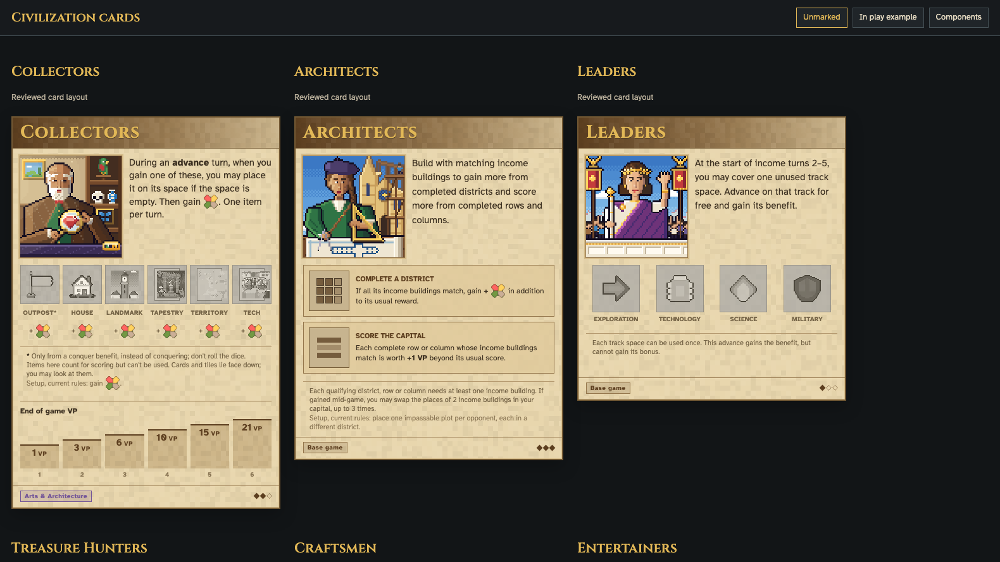

Player tokens use the owner's shaded 32×32 five-colour PNGs, reproduced exactly as SVGs. The prior flat versions are archived; stable production URLs now serve the replacements. Resources have two native sets, 24 and 48 px; the old 32 px resource originals are deprecated.
