# UI/UX manifest · phase one

This README is the implementation handoff for the first phase of [issue #3: Design every screen of the game](https://github.com/serferdinand2/the-rug-game/issues/3). It records the interface developed with lazar-milin through **2026-10-21**. The accompanying HTML pages are interactive design references for building the real Svelte game pages. They are not the playable game, a rules engine, or finished server-backed screens.

**Use this manifest and the current HTML references for UI/UX decisions.** They supersede the older main-screen design, Alagard/VCR typography, purple panel backgrounds, token-based track progress, and five-tab centre layout. The old PNGs and their reference page are preserved in [archivedpngmockups/](archivedpngmockups/README.md). Do not use them to override the phase-one layout.

This is a phase-one milestone, not completion of issue #3. The missing screens and production requirements are listed below. The project's rules research and root README's rules conventions remain authoritative for game rules; fixture values and placeholder options in these pages do not change those rules.

**[src/styles/tokens.css](../../src/styles/tokens.css) is the single source of truth for the look** (owner, 2026-10-21). It holds the colours, texture, type, spacing, layout sizes, borders, shadows and motion taken from these references, with one value per role. Where a reference page or a swatch below disagrees with it, `tokens.css` wins. This manifest stays the source for layout, roles and behaviour.

## Reference files and preview

The owner-reviewed #5 icon mockup and its linked capital terrain page are preserved in [the art review archive](../art/archive/2026-10-23-issue-5/README.md). The production SVG inventory and deferred text symbols are documented in [the asset handoff](../art/issue-5.md). These assets can be reviewed in the component library's Art sections.

| File | Purpose |
|---|---|
| [launch.html](launch.html) | Entry page: name, create/join table and public table list |
| [lobby.html](lobby.html) | Table setup, seat controls, readiness and civilization chooser |
| [main-screen.html](main-screen.html) | Play page: tracks/map, private tabs, footer decisions, city placement and player overview |
| [end-screen.html](end-screen.html) | The final standings page: player results and the selected rules version's tie-break explanation; built in #29 |
| [card-design-rules.md](card-design-rules.md) | Owner-approved Civilization, Technology and Tapestry card layouts, including sizes, effects, timing and placement rules |
| [collectors-card-options.html](collectors-card-options.html) | Five Collectors civilization card designs, printed and in play; the owner chose option B (#47, 2026-10-23). Open it from disk: it loads the art from `static/art/` |
| [screens/](screens/) | Current screenshots captured from these HTML files at 1920×1080 |
| [assets/middle-pixel-noise.svg](assets/middle-pixel-noise.svg) | Editable source of the shared pixel texture embedded in the pages |
| [tokens.css](../../src/styles/tokens.css) and [base.css](../../src/styles/base.css) | The production design tokens, fonts, page and focus styles made from these references |
| `/components.html` ([src/lib/components/](../../src/lib/components/README.md)) | The component library (#48): every component built from these references, in all its states, and the art; screenshots `screens/component-library.png` and `screens/component-library-art.png` |
| [preview.mjs](preview.mjs) | Optional local server for these references only |
| [archivedpngmockups/](archivedpngmockups/README.md) | Superseded PNGs, HTML and generator from the earlier design |

Open `launch.html` in a browser, or run this from the repository root:

```sh
node docs/ui/preview.mjs
```

Then use:

- Launch: <http://127.0.0.1:52990/launch.html>
- Lobby: <http://127.0.0.1:52990/lobby.html?mode=create&name=Cedarwyn>
- Game: <http://127.0.0.1:52990/main-screen.html>
- End-screen proposal: <http://127.0.0.1:52990/end-screen.html>

Set `UI_PORT` to choose another port. This preview is separate from the actual application on port 3020. The navigation menus and Start game button link between the reference pages; they do not create or start a real table.

The main-screen page keeps an inline snapshot of the Lighthouse footprint for standalone interaction. Its pixel texture and game art load from the repository's `docs/ui/assets/` and `static/art/` files; the preview server serves both paths, and direct file opening also works. The reference pages still load their fonts from Google Fonts, so their exact appearance needs those requests to succeed. The game itself self-hosts the same fonts from `static/fonts/`.

The reference review size is **1920×1080 CSS pixels**, at 100% zoom. Play and lobby have fixed-size canvases; launch is evaluated at the same size. There is no approved phone layout. Narrow-screen media rules left in a prototype are not a separate approved design. The play page keeps content scrollable while hiding scrollbars. Do not reflow the capital grid or enlarge its cells to fit a building.

## Shared visual language

### Typography

| Role | Font and treatment |
|---|---|
| Brand, track names, tile names, civilization names, landmark/building names, terrain names | **Cinzel**, usually 600 or 700 |
| Player names, labels, instructions, resource counts, VP, controls and tabs | **Atkinson Hyperlegible**, 400 or 700 |
| Advancement Tracks and World Map selectors | Atkinson Hyperlegible, upright; no italic styling |
| Your turn | Italic title-font treatment; it is a text label, not a button |
| Action descriptions | Atkinson; Cinzel is reserved for proper names such as Ships or Farm |
| Civilization and era | Civilization in Cinzel/gold; era after a middle dot in the legible font |

Player names must never use Cinzel. Capital headings use Atkinson except for the capital type, such as **Mountain**, in Cinzel. Right-panel tabs use the compact labels **Civ** and **Tech**; overview summary rows also use **Tech**.

The launch headline “Advance through…” and the lobby invitation use Cinzel. The launch header sentence “Build a civilization that stands the test of time”, form labels and buttons use Atkinson. These roles replace the old Alagard/VCR guidance. In code, Cinzel is `--font-title` and Atkinson Hyperlegible is `--font-body`; the size scale (`--font-size-3xs`, 10px and the smallest, to `--font-size-display`), weights, line heights and letter spacing are in `tokens.css`.

### Surfaces, colours and selection

| Role | Token | Swatch |
|---|---|---|
| Deep background / grid backing / inputs | `--ink` | `#121517` |
| Header, footer, lobby panels, overview background | `--chrome` | `#171a1d` |
| Buttons, chips, cards and list rows | `--control` | `#202529` |
| Middle play surface / pixel-texture average | `--surface` | `#242a2e` |
| Raised control / selected tab surface | `--raised` | `#30383c` |
| Panel borders / rules and separators / small-button borders | `--line-soft` / `--line` / `--line-strong` | `#3d4549` / `#465257` / `#596166` |
| Main text / muted text and inactive tabs / inactive icons and selectors | `--text` / `--muted` / `--faint` | `#e8ddc4` / `#b9af9b` / `#737d81` |
| Gold selection and proper-name accent | `--gold` | `#e2b857` |
| District boundaries, eyebrows | `--bronze` | `#b88746` |
| Primary action and current-player glow / placement, confirmation and readiness | `--action` / `--ok` | `#79b99b` / `#8fd0aa` |
| Mute slash, impassable plots, remove controls | `--danger` | `#e05f5f` |
| Exploration / Science / Technology / Military | `--exploration` … `--military` | `#3f83a8` / `#579274` / `#b57a3b` / `#a94f4f` |
| Players, seats 1–5 | `--player-1` … `--player-5` | `#4ea1d3` / `#e06a55` / `#64ae67` / `#e1b84d` / `#b07fd0` |
| Coin (markets) / worker (houses) / food (farms) / culture (armories) | `--coin` … `--culture` | `#e2b857` / `#aab2b5` / `#b88746` / `#c8644b` |
| Sea / desert / forest / grassland / mountain / unexplored | `--sea` … `--unexplored` | `#396d98` / `#c9a55d` / `#477a50` / `#91a85a` / `#85878a` / `#30383c` |
| Expansion badges: Arts & Architecture / Plans & Ploys / Fantasies & Futures | `--arts-architecture` … | `#bd9155` / `#7e9f86` / `#9d83ae` |

The references used several near-identical values for some roles, for example `#202529` and `#202629` for controls, `#4385a8` and `#3f83a8` for exploration, and three reds for the mute slash, the impassable X and the remove control. `tokens.css` keeps one value for each. Other tints, such as the gold-tinted button backgrounds, are derived from these tokens with `color-mix()`.

The pixel texture consists of small, crisp, low-contrast gray squares. Keep it visible behind both middle sections, including behind the right-panel tabs. The source SVG is 1920×1080 with 8px marks and is intended as a repeated texture. The game uses `--texture`: a 256×256 tile cropped from the source, with one path per colour, repeated over `--surface`. The same texture is used by launch and lobby; do not introduce a separate flat-background variant.

Player identity and track identity are separate colour systems. **The game uses the play page's brighter player colours, with purple `#b07fd0` for seat five** (`--player-1` to `--player-5`). The launch and lobby references still show their earlier swatches, which reuse the track colours (blue `#3f83a8`, red `#a94f4f`, green `#579274`, bronze `#b57a3b`, purple `#a98bba`); build those pages with the player tokens instead. Seat four's yellow is close to the gold selection colour, so a selection must also show its outline, never colour alone.

**Corners are square throughout** (`--radius: 0`), including selected tabs, player cards, controls and selection outlines. Lobby mute/menu controls match the game's dark 36×36 control buttons and red diagonal mute slash; the small corner radius visible in the lobby reference is not carried into the game. Ordinary panels should not gain new drop shadows. Header/footer separation uses thin divider rules; in player-overview mode remove the header divider over the overview area and keep the footer divider.

Use gold for selection, the track colours for track names, and green for the current player glow, valid placement guidance and confirmation. Keep names, outlines and symbols as additional signals; colour alone must not carry state. Use the native 24 px SVG resource icons for compact track prices, overview counts, footer costs and inline choice costs. Use the native 48 px icons for large resource choices in decision prompts. Do not scale the deprecated 32 px resource artwork.

## Launch page


**Built in #25 (2026-10-27).** The screenshot is the running game, not the mockup. It follows `launch.html`, with what the server needs added in the same look: a **Return to your game** button when the player left a running game, and loading, empty and failed states for Open tables. The rows show the code, the seats and the rules; an expansion badge appears once expansions exist. The design is `docs/superpowers/specs/2026-10-27-landing-and-lobby-design.md`.

The page flows vertically beneath the header and has no footer. The brand sits at the left, the Atkinson header sentence is centered, and sound/menu controls sit at the right. A large centered Cinzel headline names Exploration, Science, Technology and Military in their track colours.

The central panel stack is about 530px wide at the review size. Both panels have the dark header background and align to the same width:

1. A **Your name** label and name input. The explanatory text belongs inside the empty input: “Leave it empty to generate a mythical or historical name”. A blank submission generates an example name.
2. **Create a table** below the name field.
3. A thin divider paused by italic “or join friends”.
4. A table-code input with the exact left-aligned placeholder **8-character code**, in normal case, then **Join table**. Invalid codes show a short validation message. The prototype accepts eight alphanumeric characters.
5. A separate **Open tables** panel underneath. Each example row has Join on the left, the eight-character code with five small seat rectangles underneath, and rules/expansion badges in the remaining area. Fill occupied seat rectangles from left to right with player colours; do not replace them with “2/5” text or fictional table names.

The three advertised tables are fixtures. Production must obtain open tables from the table API and define loading, empty, full, unavailable and failed-join states. Creating and joining in this mockup only navigates to the lobby with example query parameters. The local name generator, table codes and expansion badges are not server implementation.

## Lobby page


**Built in #25 (2026-10-27).** The screenshot is the running game. Where the mockup and the game's rules or server differ, the owner's rule applied (2026-10-27): the mockup decides the look, the game decides what works.

- **Readiness** is a server toggle and shows on every online seat; the host may start without it. A host change to the rules, variants, timer or undo clears it.
- **No civilization in the lobby.** Each player is dealt two civilizations once the game starts and keeps one (#28); the seats show no civilization line, and there is no chooser.
- **Open seat**, online, copies the table code: a friend fills a seat by joining with it. **Take the seat!** is left out, because the server seats joiners in order. At a hot-seat table, Open seat opens a name field (SeatCard's `add` state).
- **Settings:** Rules, Expansions ("Base game only for now" until there are any) and **Turn timer** on the left; **Undo rules** and the five optional variants as Yes/No rows on the right. The mockup's Map row and its three sample rule rows aren't game rules, so they are left out. Only the host changes them; the others see them disabled.
- The mode switch changes only while the host is alone at the table.

The lobby uses a fixed 1920×1080 canvas. The main stack is **1000px wide**, centered horizontally, with the invitation above it. Its intentional two-line break is:

> Invite your friends, choose your civilization,<br>
> and prepare to make history.

Do not move the whole stack upward when opening civilization choices. The chooser is inserted below the player panel and pushes the rules panel down.

### Top controls

The first row has two compact panels. The left contains **Mode:**, Online mode, Local mode, and a right-aligned read-only code field immediately beside **COPY**. The selected mode is filled with colour and uses dark inverse text, without changing font weight or shifting its neighbours. Local mode replaces the code and copy control with the right-aligned sentence **“Classic hot-seat gaming. Your friends and you will share a screen.”**

The right panel explains its controls in exactly two lines:

> Start the game, mark yourself<br>
> as ready, or leave the table!

Give each line enough width to prevent a third line. The Start game (green), I'm ready (gold when selected), and Leave table (red) buttons share one row. The ready checkmark is green. Readiness also appears beside the current player's YOU and HOST labels. In the example, the blue player is the host.

### Player cards and seat states

The **Players** heading is Atkinson. There are five equal-width slots. Each filled card and each empty slot occupies the same **112px total height**. A pair of Open seat/Add bot choices must occupy exactly one filled card's width and height, with no growth of the grid row. The gap between adjacent slots remains constant.

Joined-player cards have a thick border in the player's colour. Player names use Atkinson. The civilization name or Choose civilization control uses Cinzel/gold. YOU and HOST are small gold text at the top left, separated by a light middle dot; readiness follows them. Do not use the old coloured dot or a separate “active player” label.

| Slot state | Visible controls | Host X result |
|---|---|---|
| Unconfigured slot | Two stacked, borderless choices: **+ Open seat** and **+ Add bot** | No X in this state |
| Open seat | One full-size gold-highlighted **Take the seat!** prompt | Return to the two choices in the same slot |
| Joined player | Player name, civilization and applicable badges | Return to the two choices in the same slot |
| Bot seat | Bot name and editable civilization | Return to the two choices in the same slot |

The X appears at the top right on hover/focus where applicable. It must never hide or remove the grid slot, close a column, or shift the other cards. Taking an available seat moves the example local player into that seat. The mockup does not enforce real authentication or host permissions; production must do so server-side.

**Bot scope clarification from the designer:** these controls describe the seat UI and host interactions. They do not decide which bots the game will use. Bot types and their rules are work for later; this manifest does not change the existing official-solo-bot policy.

**Add bot is shelved (owner, 2026-10-21).** Don't build the **+ Add bot** choice, the bot seat row above, or the host's bot civilization control below. Until it returns, an unconfigured slot shows only **+ Open seat**, filling the same 112px slot, and the host's X returns a slot to that single choice. Solo play with the official Automa and Shadow Empire still needs its own setup design under #3.

### Civilization chooser

Mockup only: the built lobby has no chooser, because the rules deal civilizations once the game starts (see the #25 note above). The choice of two dealt civilizations is a decision prompt (#28).

- Clicking your chosen civilization reopens the chooser, so it can be changed.
- The host can also open the chooser from a bot's civilization control and change that bot's selection. (Shelved with Add bot.)
- The panel's border matches **the player being edited**, not always the local player. Seat five therefore opens a purple-bordered chooser.
- **Choose your civilization** is an Atkinson heading. **Random** sits on the same row at the top right, before the list of choices. Civilization tiles use Cinzel.
- Choosing a tile, or Random, updates the target player and closes the panel. The prototype offers five example civilizations and local random selection; production must use the legal available civilization data.

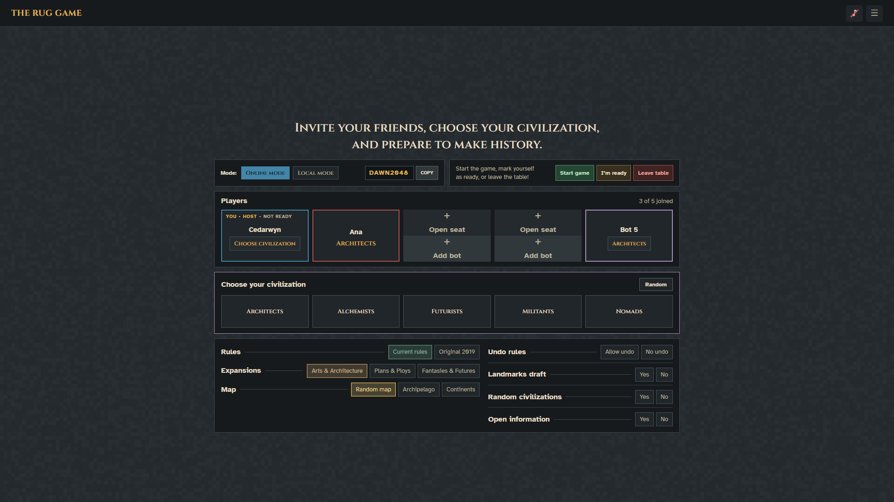

### Table settings

The full-width settings panel sits below the players and optional chooser. Its left side has Rules, Expansions and Map rows. Each row reads **title → thin rule → choices**, rather than stacking the title over the choices. The right side has Undo rules and separate rows for Landmarks draft, Random civilizations and Open information. The latter rows use Yes/No pairs. Selection uses the option's reserved colour.

The arrangement and selection styling are the reference. Labels such as Archipelago, Continents and the additional-rule choices are mockup examples, not additions to the game's rule set. Derive supported settings, incompatibilities and mode-specific controls from the approved specification and engine. Solo/Automa difficulty, timer, readiness gates and complete original/current-rules setup still need integration and design review.

## Play page


**Built in #26 (2026-10-27): the frame, the shared board and the turn.** The screenshots below are the running game; the one above is still the mockup, for the player area (#27).

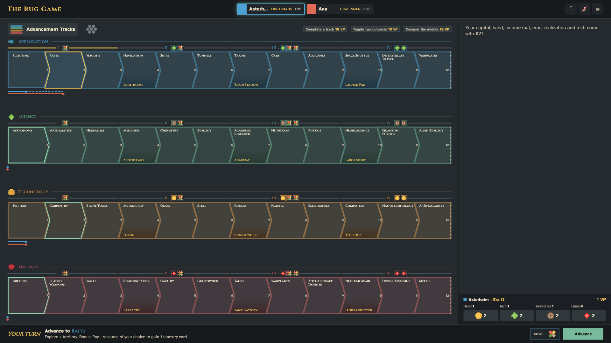

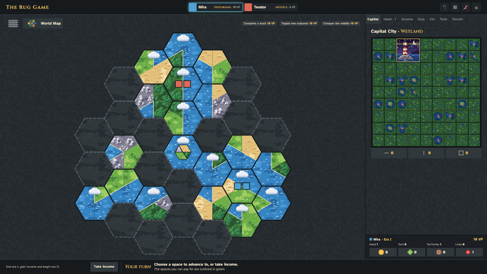

- **The World Map** is the real board's hex grid (owner, 2026-10-27): 34 hexes for 1–3 players, 61 for 4–5, flat-topped as on the printed board with start 1 at the top. Each corner of a territory is a wedge of its terrain, an island sits in the middle, and unexplored hexes are dark and dashed. Outposts are squares in the player's colour (toppled ones lie down), tokens are circles. Since #6 every wedge and island shows its terrain's picture (`hex/*`), clipped to its shape, with a coast where land meets sea and the cloud or volcano where R77 puts them, so a tile in any turn stays crisp and shows the terrains the engine scores.
- **Each space shows its benefit, and its bonus in a small box** (#59, 2026-10-27), as the printed board does: resources, buildings and track symbols are their art; the game symbols without art yet are short words (Tile, Tapestry, Explore, Conquer, Invent, Science die, VP), as #5 decided; a benefit without its own benefit carries a red X; "or" joins a choice. The bonus box shows its price, an arrow and what it gives. The full words are the space's tooltip and label. A board with height to spare makes the spaces up to 1.25 times as tall as wide; on a short screen (1366×768) the symbols shrink and a few bonuses are cut off, with the words still in the tooltip.
- **The spaces a player can pay for** have a green outline; the selected one keeps the gold outline. The footer then shows the space's benefit and bonus in words, its price and **Advance**, and asks for the payment in the decision panel when there is a choice.
- **The achievements** sit in the head of the shared area, with the claimants' colours and the next VP.
- **The decision panel** is the mockup's prompt, designed per decision in #28 (below). A map decision lights up its hexes and leaves the map clickable.
- **The header** has the turn clock when the timer is on (red, with the seconds in words, in the viewer's last 5 seconds) and **Undo**.
- **Your overview** at the foot of the player area is the mockup's compact block; its last count is complete capital lines.

**Built in #27 (2026-10-27): the player area and the players overview.**

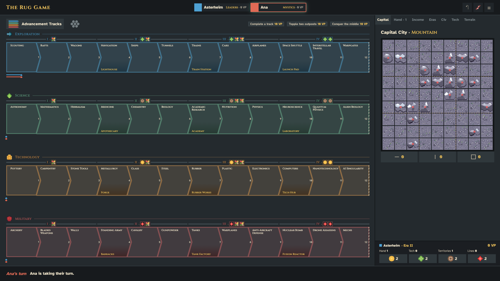

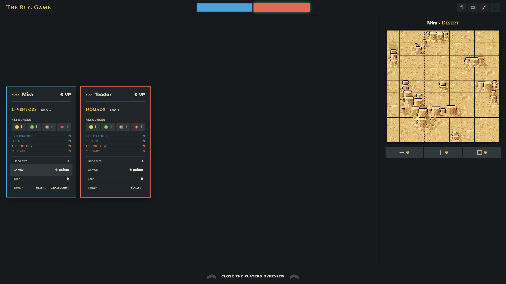

- **The tabs** are the mockup's: Capital (the seat's real mat and plots, landmarks over the edge allowed, the counters, and what lies beside the mat), Hand (the tapestry cards overlapping; hovering shows one in full over the shared area), Income (the four rows, covered spaces with their building, exposed ones with their reward in words), Eras (the four slots, a face-down card shown as such, the active card in full), Civ (the reviewed card for the twelve base civilizations with a recipe, a plain portrait card for the other four until #47), Tech (the three rows and the display with the deck count) and Terrain (territory tiles drawn like the map's, and space tiles).
- **Real cards:** the tech and tapestry cards are built from the engine's data through `describe.js`; no text is invented. Lazar's fixtures stay for the library and the card review.
- **Tab switching:** a decision about a tab's things opens that tab by itself.
- **The players overview** opens from the chips, as in the mockup: one card per player, and Capital, Civilization or Tech of any player on the right. Opponents' hands appear only as counts.

**Built in #28 (2026-10-27): the decision prompts.**

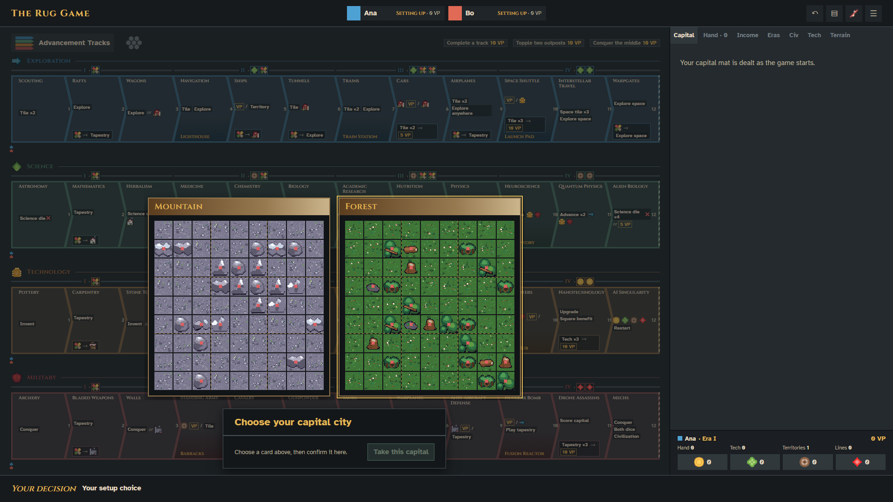

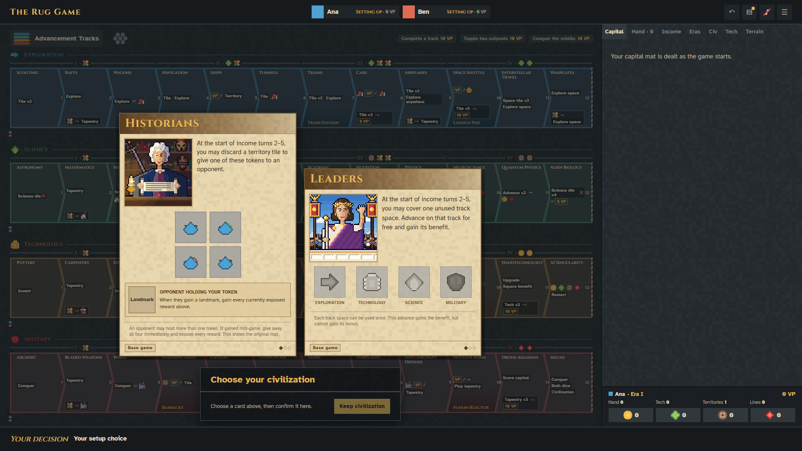

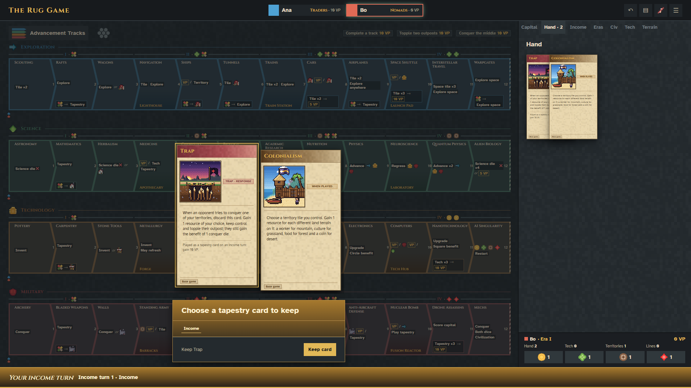

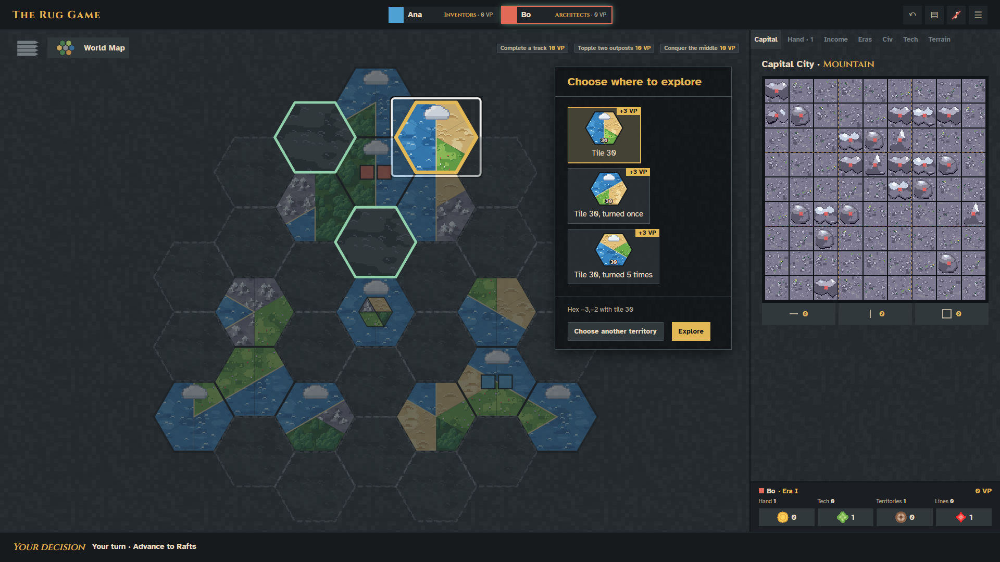

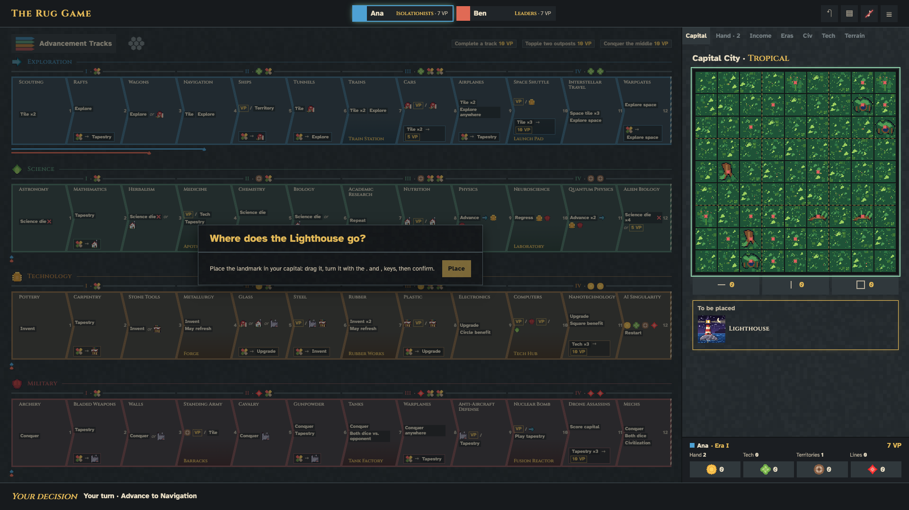

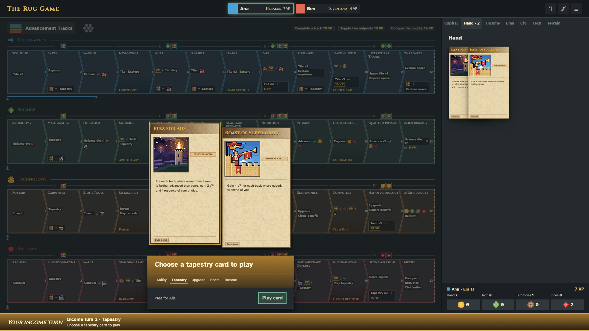

- **One model for every decision:** `src/lib/prompts.js` turns the open decision into a title, an instruction, a layout and one option per answer, each chosen in the panel, on the card shelf, on the map or on the capital. Nothing is sent until Confirm, even with one answer.
- **Art, as in the mockup:** resources at 48 px with their counts, track symbols, buildings, landmarks, civilization portraits, space and territory tiles; dice faces and VP are words (#5). A bonus shows its cost and takes its track's colour.
- **Cards** sit on a shelf above the panel, as full cards: tapestry cards (play, keep, discard, copy, respond), tech cards with the deck as a card back, both civilizations at setup and the two capital mats. Hovering a tapestry or tech card shows it in full.
- **Civilizations and capital mats** (2026-10-27, #56–#58): the civilization cards are whole, 425 px wide at their own height, as the decision mockup shows them, and the gold outline wraps each card exactly. A row too tall for the shelf is scaled down just enough, never below 0.75; past that the shelf scrolls (the Mystics at 1440×900). Each capital mat is its real 9×9 grid, 380 px, composed from the terrain tiles with the table's seed, so it looks as it will in the Capital tab; the example mat art is no longer used. A panel with no options of its own has no content area: its status line gives the instruction, leaving the shelf more height.
- **The map:** choosing a territory lists its answers. An explore starts on the best-scoring tile and turn, previewed on the hex, and lists every tile in every turn with the VP it scores.
- **The capital:** a building's open plots are lit on the Capital tab and a click previews it there; a landmark comes from the tray, snaps only to the engine's legal places, turns with R, and the piece's own lock sends it. Beside the mat and the Craftsmen's columns stay panel choices.
- **The income turn** is gold, as in the mockup: the panel's title and step strip (Ability, Tapestry, Upgrade, Score, Income, only the steps that turn runs) and the footer's "Your income turn · Income turn n · step".

### Three horizontal bands

Use a compact, full-width **header**, **middle play area**, and **turn footer**. Header and footer have the same short height, approximately 58px in the reference, and the same dark gray background. There are no outer side borders. The middle uses mid-gray pixel-textured surfaces, divided **3/4 shared area to 1/4 player area**.

The header has the title at left, centered player chips, and controls at right. Each chip shows the player name in Atkinson and civilization in Cinzel/gold, with VP. Keep chip widths and gaps constant. A player-colour square begins each chip; when the overview opens, a separate colour layer slides across the existing chip and its text disappears without changing its dimensions. The current player has a green glow around the whole chip, not just the name. Blue is the current player in the fixture.

The reference menu navigates among launch, lobby and game mockups. Sound toggles the red diagonal slash over a still-light note; the prototype plays no audio. The undo/history icon is visual only. Production menus, history and audio services are outside this phase.

### Shared-area selectors

At the top of the shared area, show the selected selector's icon and inline title. The selected box keeps the light raised-surface highlight permanently; do not rely on hover to show it. Inactive selectors are gray icons with the title collapsed.

- **Advancement Tracks:** four short, right-pointing bands, coloured with the four tracks when selected. Their horizontal length is reduced relative to the first icon draft.
- **World Map:** seven point-up hexagons in a **2 / 3 / 2** arrangement, coloured by terrain when selected.

Both titles use upright Atkinson. There is no redundant “Shared board” heading or player colour-key strip. The map is a schematic view in this handoff; exploration/conquest targeting remains to be designed.

### Advancement tracks

Each of the four track sections has this order:

1. Cinzel track title at the left, followed by a thin separator line to the right edge.
2. Four price groups, each centered above its three tiles, interrupting a horizontal line. Each interruption contains Cinzel **I–IV**, a middle dot, and the existing price symbols. Keep the gap above and below the cost line even and compact. Hovering a tile turns its group's cost line gold; the line has the same visual thickness as the player-progress lines.
3. Twelve tiles, without a separate Start tile. Titles sit at the top left in Cinzel. Track names are sized to fit their allocated heading area.
4. Player-progress lanes underneath, with room between tracks. Use one lane per present player, up to five, and reclaim missing-player lanes.

The stable tile body is approximately square. A right-facing arrow tip extends beyond the body and overlaps the next tile without moving the next tile's start. Subsequent tiles have a matching left inlet, about **16px at the reference size**. The first left edge is flat; the final tile is square with a diagonally dashed finish-line right edge. Do not draw a coloured/thick left inlet border on tiles after the first. Keep the other polygon borders angular. The subdued small number belongs in the tip area in Atkinson, not as a prominent top-of-tile label.

Landmark milestones show the matching landmark illustration with a small Cinzel name in a **gold-tinted highlight** at the bottom of the tile, above the track-space name. Keep both labels within the pointed tile silhouette. A selected tile gets a gold polygon outline without growing or shifting the tile.

Progress lines start below the first tile and stop beneath the middle of the reached tile. Leave at least one line-thickness, preferably 1.5, between lanes. Use a small terminal mark; the all-square final mockup makes it square. Hovering a next tile extends the relevant player's line to that tile's middle with a dashed line of the same thickness. Do not reintroduce one simple token per tile as the primary progression display. The old achievements/“3 points” strip beneath the tracks has been removed from this layout.

### Decision prompt previews

The **Decision examples** control opens interactive layout fixtures for payment, resource, territory, capital-plot, card, civilization setup, die and trap decisions. These examples test presentation and selection only; the engine supplies legal options, costs and outcomes in production. A prompt covers only the shared left three-quarter field, leaving the private right-hand area visible. A translucent dark scrim reveals the board beneath it. The panel sits a small distance above the footer, centered horizontally. Its width and height follow the decision content up to the available shared-field size; long decisions scroll inside the panel. Ordinary panels use a darker layer of the same pixel-noise texture as both middle regions, with a thin border on all four sides matching the main header and footer separators. Choice artwork uses the native art files, including 48 px resource icons where a resource is the primary choice. Card selection presents actual artwork cards with drop shadows **above** the panel; the panel holds the instruction and confirmation action. The civilization setup example models two dealt cards when Random civilizations is on.

The chained **Ships → Farm** preview opens only after the player presses **Pay & build** in the optional Ships footer. It starts with a benefit prompt offering **Pay & build** or **Cancel**; Skip remains in the footer. Paying selects and highlights the Capital tab. The player chooses any empty, passable square directly on that mat; no separate tile list or persistent plot highlight is shown. Choosing the square places the visual Farm fixture and opens the **Complete** stage with its actual square and one **Continue** action. The stage labels describe progress; they are not menu choices. The prompt title uses gold Atkinson, and its bottom section takes the source advancement track colour, matching the optional footer effect. Cancel returns to the optional footer without placing anything. No resource balance or saved game state is changed.

The footer's **Take income** button opens an interactive income-turn-4 layout fixture. The footer says **Your income turn** and has a vertical gold gradient for the whole flow. The decision prompt's gold gradient covers only its title and step strip; the instruction body and action footer retain dark backgrounds. The sequence follows the engine's order for Alchemists in era III: stop or take one more science-die roll while the **Civ** tab is focused and highlighted; choose a tapestry card for the era-IV slot with the **Eras** tab focused and highlighted; choose three resources for being first of both neighbours to begin that era; optionally choose a technology in the focused **Tech** tab to upgrade; review exposed VP scoring and income in the **Income** tab; then see a completion summary. Tapestry cards appear above the prompt with drop shadows, and **Play card** in the prompt confirms the selection. The upgrade prompt has no technology-choice buttons: choosing Paper in the Tech bottom row moves it to the middle, or choosing Bakery in the middle moves it to the top. Continuing without a selection skips this optional upgrade. The deterministic die and card choices are examples only. The Income tab uses the game's four six-space building rows: the first space is always exposed, and each removed building exposes the next space. This fixture removes two markets, houses and farms, and one armory. It shows the printed rewards from `src/lib/engine/data/income-mat.js`. At the owner's request, the 8 VP completion result remains an illustrative UI figure rather than a calculation of every printed effect, including capital scoring on exposed House spaces. The bonus and actual rewards depend on game state in production. **Complete** is a visible end state with Continue; it does not change saved resources, VP or era in this standalone mockup.

### Right-hand tabs

The right-hand 1/4 has **Capital · Hand (with size) · Income · Eras · Civ · Tech · Terrain** tabs, with the hand count part of the Hand control. Each tab's width follows its text. Reserve the selected/bold width before selection so nothing moves horizontally when a tab changes. Match the shared selector's active surface and text colour. The tab bar itself is transparent over the same textured background as the body. Hand, Eras, Tech and Terrain headings use beige Atkinson. Hand shows four overlapping tapestry cards, with the hovered or focused card brought to the front. Tapestry choices above decision prompts use the same overlap behavior. Eras shows the currently active tapestry as a full card, with prior eras selectable beneath it; the panel can scroll without a visible scrollbar. Maker of Fire is a printed starting era without its own card artwork. Era labels are beige Atkinson, while tapestry titles are gold. The open era-IV slot highlights during tapestry choice, and the played card becomes the active full card. Civ embeds the actual shared 425 px Alchemists card component through the card-review page's `?embed=alchemists` view. Tech has top, middle and bottom rows; middle marks the circle benefit and top marks the square benefit. Its three example cards include two overlapping in the bottom row. They become selectable only during the income upgrade step; hovering or focusing an overlapped card brings it to the front.

A compact **Your overview** section is fixed at the bottom of the right-hand quarter, outside the tabs. It shows player identity, era, VP, hand, technology, territory and capital counts, plus the four native 24 px resource icons in rectangular `--raised` boxes. The civilization name is omitted here; the Civilization tab and player overview carry it. Its top rule matches the divider between the shared and private areas. It stays visible as the player changes tabs and disappears with the whole middle region when the players overview opens. The values here remain fixture data.

Capital is the developed example. Income shows the printed building spaces and the buildings covering the later spaces. Hovering or focusing an income building on either the Income mat or the Capital mat adds a transparent overlay in its associated resource track colour: market/coin uses Technology, house/worker Science, farm/food Exploration, and armory/culture Military. The overlay adds no border. The Income mat heading is beige except for its gold era. Eras, Civ and Tech have focused income-step examples, and Hand shows a four-card stack; their full game contents remain to be designed. Terrain still shows placeholder copy. Their tab labels and navigation pattern are approved references; their detailed contents are not finished designs.

Civilization cards use the shared 425 px frame documented in [card-design-rules.md](card-design-rules.md). The Civ tab's embedded Alchemists card comes from that same component, so its text and layout remain in sync with the card review.


### Footer and Ships example

The footer always describes the current decision or what another player is doing. Instructions use Atkinson; proper names may use Cinzel. A selected track space's proper name is coloured with its track. Cost symbols sit together in a container immediately before the action buttons at the right.

| State | Footer content and interaction |
|---|---|
| Neutral | “The table is waiting for your move”; income description and Take income are visible on the left, with no surrounding box. Only the income button highlights on hover. |
| Tile selected | Gold outline on the tile; footer changes to Advance to [name], its benefit, price and commit action. Income moves into a hover/focus reveal accessed through Your turn. |
| Ships selected by blue | “Gain 1 VP per territory you control. You control 4 territories.” Price icons and **Advance · +4 VP** are shown. |
| Ships committed | Footer changes to the exploration-coloured optional **Build a Farm [farm icon]?** prompt with price, **Pay & build** and **Skip**. Income reveal is disabled in this state. |
| Optional choice finished | Skip resets the Ships demonstration. Pay & build opens the chained benefit prompt. Paying then choosing a square places the visual Farm, shows the result and resets the footer so the example can be repeated. |

The income description and button are separated from Your turn by a thin vertical rule after the button. The revealed version starts at the left edge where Your turn sat and has the same spacing discipline. Do not bring back the enclosing income box. The income button now starts the layout fixture described above. Actual decisions, reward amounts and state transitions belong to the engine-backed game screen.

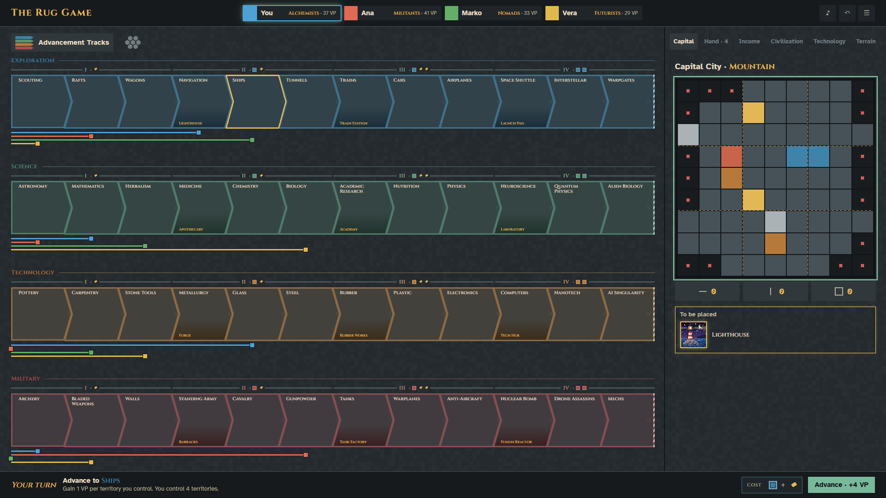


No costs are really paid and no VP totals are persisted. The chained example places a visual Farm fixture on the mat, which clears when the footer sequence is started again. All other track selections use generic fixture descriptions. Read actual legal moves, benefits, costs and optional decisions from the engine when implementing this page.

### Capital city and landmark placement

The capital is always **9×9**. Its title is Atkinson with only the mat type, such as Mountain, in Cinzel. There is no separate legend or second city grid. Three equal-width completion counters sit beneath the grid with a gap equal to their mutual gaps; together they span the grid width. Use horizontal-line, vertical-line and square symbols for rows, columns and districts. Do not add the heading “Completed”.

- The Mountain example uses the canonical 9×9 passable/impassable mask from `src/lib/engine/data/capitals.js`. Each plot uses a deterministic mix of the native Mountain open or blocked terrain tiles. Impassable plots retain a small, thick red X. District boundaries are thin dashed overlays between 3×3 districts; they do not recolour the ordinary plot borders.
- Completion counts derive from filled rows, columns and nine-plot districts. Hovering a counter adds one flat transparent green rectangle across each whole completed group. It has no border, no glow, and covers all buildings, including a newly locked landmark. Do not highlight each plot as a separate green box.
- A **To be placed** section appears only when an item is pending. It is full width, outlined to attract attention, and holds the item's Cinzel name. Selecting the item gives it an outline. The name stays in the tray and is not shown over the grid while dragging.
- The Lighthouse example uses the actual landmark illustration and **four plots, a 2×2 footprint**. The whole piece is draggable. On release, it snaps to a legal position; it cannot enlarge or wrap the grid. It can be moved again before confirmation.
- Once positioned, small green rotation and confirmation controls sit on the piece, with confirmation under rotation. A return control sends it back to To be placed; dragging it back to that tray also returns it.
- Keep the capital's green outline visible while placement is pending, including while idle. It also guides movement into the grid. The Lighthouse's own outline is exploration blue, not green.
- Confirmation locks placement, hides placement controls and removes the grid's pending-placement outline. The fresh-placement glow clears after subsequent hover or a tab change. Unconfirmed placements do not count toward completed groups.

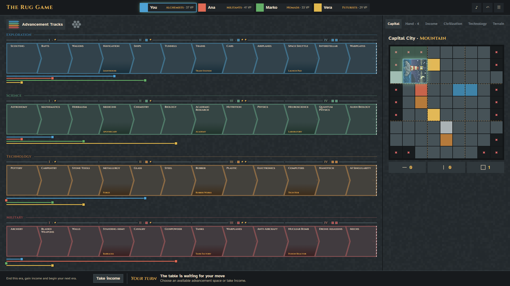

The Mountain passability pattern matches canonical capital data, while its tile variants, placed buildings and occupancy remain review fixtures rather than a valid saved game. Production must use the canonical capital data, occupancy model and landmark footprints; the screenshot is a layout and interaction reference.

### Player overview and inspecting another player


Clicking any header player chip or the player-chip area opens an overview extending from header to footer. It retains the **3/4 + 1/4** middle split. The overview background is exactly the header/footer gray, continuous with the header over the left 3/4, without a gradient or shadow underneath it. Header chips keep their dimensions, fill with player colour, hide all text and retain the current player's green glow.

The left region holds vertically centered player cards, each **one fifth of the left 3/4**, not one fifth of the full screen. The four example cards have equal fixed height sufficient for their contents. Their borders use player colours. Player names are left-aligned in Atkinson, with VP held at the right. The blue player's YOU · HOST indicators precede the name without shifting the row vertically. Do not reserve space for the discarded colour-square icon in these card headings.

Each card contains, in order:

1. Name and VP.
2. A selectable Cinzel civilization name with era after a middle dot, aligned to the left and separated clearly.
3. Compact **Resources** in Atkinson, with the same placeholder icons used in tier prices and their amounts.
4. Four compact track rows: Cinzel track name, a thin unfilled guide rule, and reached-space number. These rules are not progress bars.
5. Hand size as a count, Capital points, Tech count, then Terrain. Do not add a Space tiles row.

Civilization/era, Capital and Tech summary rows are clickable examples. Hand size, resource amounts and track summaries are not clickable. A selected row gets a whole-row gray background without moving its text, expanding the card or keeping an internal border around letters. Hide the usual row-bottom separator while that row is selected.

The right region initially says **Waiting for overview** at its centre. Ana's Capital row is the developed drill-down: it shows a second 9×9 capital with the same sizing, red Xs and completion-counter layout as the ordinary right-panel Capital tab. Its example filled rows, columns and districts can be inspected by hover or toggled by click. Other clickable rows only demonstrate selection and retain the waiting panel; do not treat them as completed views. Opponents' hands remain private and show counts only.

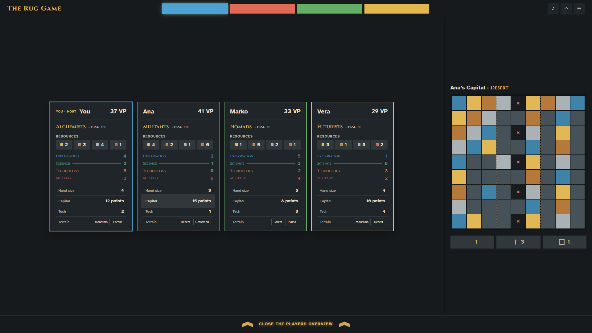

In overview mode the footer is always the base dark gray, even if Ships is awaiting its optional action underneath. It contains only bold uppercase Atkinson **CLOSE THE PLAYERS OVERVIEW**, with one subdued upward chevron on each side. Both text and chevrons glow gold on footer hover. Clicking that footer, the header players, or outside the overview's player/drill-down regions closes it. Preserve the underlying decision state.

## Assets and provenance

- The pixel SVG is included as [assets/middle-pixel-noise.svg](assets/middle-pixel-noise.svg). The main-screen mockup loads it by reference for both the board and its darker decision prompts; other HTML references may embed copies. Keep those copies in sync if editing the texture. The game's tile, `src/styles/pixel-noise.svg`, is its top-left 256×256 with one path per colour; crop it again after editing the source.
- The Lighthouse SVG is a snapshot of `static/art/landmark/lighthouse.svg`, imported while the mockups were based on upstream commit `a583cf1`. Its 2×2 footprint is from `art/footprints.js` at that point, now `src/lib/art/footprints.js`. It is embedded in `main-screen.html` only for standalone review.
- The real game must reuse stable asset IDs and the canonical `src/lib/art/footprints.js` data. Do not introduce another production footprint table, duplicate the full artwork tree into `docs/ui`, or copy large inline SVG blobs into Svelte components.
- Existing generated game artwork remains under the art toolkit. The complete catalog is in the Art part of the component library (`/components.html`, with `npm run dev`). This handoff does not change the approved art style or regenerate game assets.
- The game self-hosts Cinzel (one variable file, weights 400–900) and Atkinson Hyperlegible (Regular 400 and Bold 700) in `static/fonts/`, with their SIL Open Font License notices. They come from Google's own font repository, [google/fonts](https://github.com/google/fonts). The reference pages load the same families from Google Fonts. The superseded Alagard and VCR OSD Mono files are kept only in [archivedpngmockups/fonts/](archivedpngmockups/fonts/) for the archived page.

## Implementation boundaries and phase two

Build real pages with the repository's Svelte 5/JavaScript conventions. Port the visual roles and interactions into reusable components and shared tokens; do not ship these standalone HTML files as the game client. The sample names, cards, map, code, VP, incomes, resource amounts, legal placements and progress are fixtures. The server and engine determine permissions, privacy, legal choices and persistence.

The following are **not complete** in phase one:

- Every decision family: payment, choosing resources, hexes, cards, dice, trap responses and all chained decisions.
- The full income-turn sequence, income mat, tapestry play and technology upgrades.
- Production map exploration/conquest interaction, five-track Arts & Architecture layout, the full right-tab contents and all opponent drill-downs.
- Full setup for solo play, official bot controls, Automa difficulty, timers and every supported setting combination.
- End-of-game results, reconnect/away states, table errors, loading, empty states and complete production menu/help.
- Keyboard alternatives for every pointer/hover interaction, visible focus, proper tab semantics and reduced-motion handling. These remain required by [CONVENTIONS.md](../../CONVENTIONS.md); prototype hover-only controls are not permission to omit them.
- Production wiring for the existing native 24 px and 48 px resource icons. (The unified production fonts and palette are done: `tokens.css` and `base.css`, 2026-10-21.)

The phase-one HTML is the visual and interaction baseline for #25–#30. Complete the missing designs under #3 before treating their layouts or rule settings as approved. Keep #3 open until its remaining checklist is finished; this commit is a **Refs #3** milestone, not a closing fix.

## Review and maintenance

The current screenshots are taken at 1920×1080 from these exact references, with the two selected fonts loaded. During the handoff, the references were checked from both disk and HTTP for navigation, seat-state transitions, targeted civilization selection, random selection, readiness, Ships/optional reset, overview switching and Lighthouse placement.

Validation on 2026-10-21:

- Browser walkthrough passed with no page-script errors or failed local requests. It checked all five slot dimensions, both X transitions, fifth-seat purple targeting, chooser reopening and random selection, the green ready check, local mode, 48 track tiles, footer state changes, unchanged header-chip dimensions, Ana's 81 plots, and drag/rotate/return/lock of the Lighthouse. Locking it into the top-left district changed the district counter to 1 and produced one continuous completion overlay.
- The preview served all three pages, query-string lobby URLs and the SVG source successfully. Direct-file loading also passed. The standalone main screen has no external JavaScript import.
- `npm run format` and `npm run check` completed; the latter reported **0 errors and 0 warnings**. Formatting-only line-ending changes outside the handoff were removed.
- `npm test` built the client successfully and passed **100 of 102 tests**. Two unchanged server tests fail on this Windows environment: `starts when run through a symlinked path` requires symlink privileges (`EPERM`), and `a file that cannot be read answers 500, not an empty 200` assumes Unix-style `chmod` read restrictions. This documentation handoff does not change the server or those tests.

When revising a reference:

1. Edit the current HTML and this manifest together. Preserve the distinction between intended behavior and demo-only shortcuts.
2. Review it at the desktop reference size, including selected, hovered and expanded states.
3. Replace the relevant current PNGs in `screens/` and the root README's **Current interface** section in the same commit.
4. Retain `archivedpngmockups/` as historical material. Its generator creates the earlier design only; it must never overwrite the current `main-screen.html`.
5. Record newly approved product or rules decisions in the design specification as well, rather than inferring them from a fixture label.

The component library now uses the issue #5 SVG artwork in resource symbols, income-building plots, track headings and player progress tokens. CapitalGrid composes its background from tile SVGs using the supplied biome and visual setup seed. The six full mat SVGs remain examples only; actual game mats are composed from tiles.

## Civilization cards: owner decisions and components (2026-10-24)

[Card design rules](card-design-rules.md) is the extensive generation specification: latest accepted sizes, palette, typography, artwork, square placements, inline resources, covered rewards, legal connectors, prediction/scoring boxes and the civilization pattern recipes. It supersedes the older 456 px width and the discarded resource-circle experiments.

[The card review](collectors-review.html) now renders the same Svelte components as `/components.html#civilization-card`, including empty/in-play examples. It is a production build entry as well as a development URL. The previous static implementation is archived in `archive/2026-10-24-civilization-review.html`.


Issue #47's civilization-frame and reusable-pattern portions are covered. Other card families, all-card rules/reference data and in-game reference access remain. Issue #3 gains the civilization detail-layout foundation; the complete income, decision and result flows still need review. The examples identify original mats where applicable; sample highlights are not engine state.

## Technology and Tapestry cards (2026-10-27)

Technology and Tapestry cards now use the reviewed frames from the Second Tapestry UI card study. The shared `TechnologyCard` and `TapestryCard` components appear in the component library, and their layout fixtures are used in the main-screen Hand, Eras, Tech and Tapestry-choice shelf. Technology cards are 425 px horizontal cards with full art, square/top and circle/middle effects, and right-aligned grey prerequisite boxes. Tapestry cards are 319 px wide with the timing tag beside the 160 px portrait; Trap uses a red title band. The exact authoring rules and fixture limits are in [card-design-rules.md](card-design-rules.md). The game-backed card chooser and complete card reference remain part of #27 and #47.

Hovering or focusing a Technology or Tapestry card brings it above overlapping neighbours without shifting it and shows its complete frame centered over the shared play area. A translucent dark scrim leaves the board visible, while the card in the private tab glows gold. Era I is a static red **Maker of Fire** label in Cinzel without hover treatment; named tapestry cards in the Eras rows use Cinzel while era numbers and unchosen slots use Atkinson. Before the income tapestry step, the next slot reads **Not yet chosen**. Earlier tapestry cards can still be selected for inspection. Civilization choices use the full 425 px reviewed mats above their decision prompt, with a scrollbar-free scroll area when needed.

## End-screen proposal (2026-10-27)

[The end-screen reference](end-screen.html) uses the same header, 3/4–1/4 split, pixel texture and footer as the game screen. **Game complete** uses Cinzel in both header and footer. The shared area ranks every player with their colour, gold Cinzel civilization name and final VP. Selecting a player's name expands that row to show the sources of points already awarded during play; multiple rows can stay open for comparison. The private area gives the current player’s result and explains ties step by step. The placement (including shared first) and landmark names use gold Cinzel; resource counts and explanatory text stay Atkinson. Expansions use the coloured boxed badges from the table UI. The example switches between current rules, original rules and a shared victory. All three placements and tie details come from `rankPlayers`, including skipped places after a shared victory. There is no second scoring pass. The footer offers board review and a return to tables.

This page is a **proposal pending owner review**. The example names, score-source totals and expansion badges are fixtures. Production should show the selected table rules and results from completed game state, and should group recorded VP awards by their source for the expanded rows rather than recalculate VP. Current `vpGained` events record the amount and total but not the source, so the scoring event data needs provenance before this breakdown can be game-backed. Solo outcomes, rematch setup and the waiting view for players who finish before the table also need design review. These outstanding parts keep issue #3 open.

**Built in #29 (2026-10-27): the results, the log and the scores.** The screenshots are the running game.

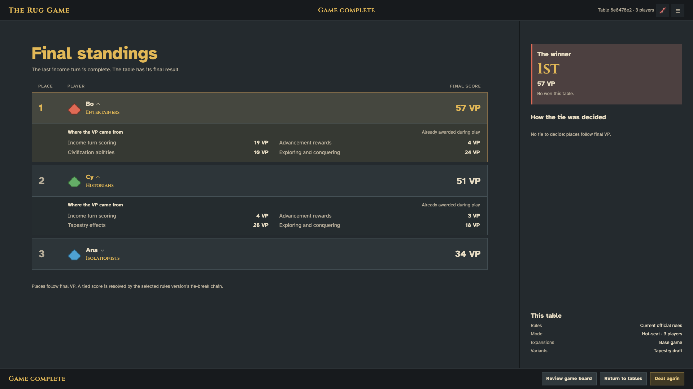

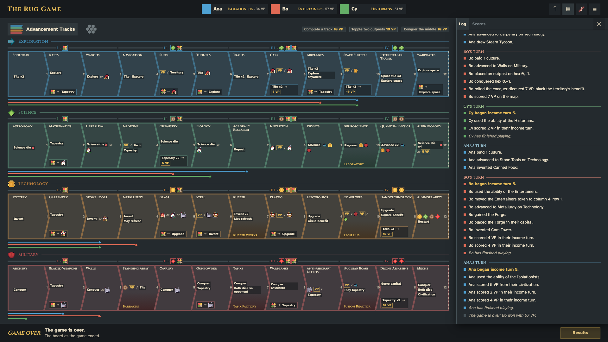

- **The results** follow this proposal with the finished game's own data: the engine's ranking (shared places repeat and the next skips), each player's VP by source as awarded during play (the engine now records where every VP came from, so nothing is scored again), the tie steps from `rankPlayers`, and the table's rules, mode, expansions and variants. At a hot-seat table the result box shows the winners, since the screen belongs to everyone. The footer adds **Deal again** for the host; **Review game board** shows the board as it ended, with a **Results** button back.
- **The log and scores** open from the header's ▤ button, over the player area: the log names every player's moves in plain words, with a rule between turns, gold income turns and italic notices (a timeout, an undo, the end); the scores list the players by VP with their sources and tiebreak values. A gold dot marks entries not yet seen.
- **Sound and motion:** sound cues (muted until switched on) mark your turn, an advance, a placement, a reward and the end; a changed territory pulses, a new building glows, a chip's VP pops and the progress lines grow. Nothing replays after a refresh, and nothing moves under reduced motion.
- **Table settings** in the header menu let the host change the turn timer and undo during a game.
