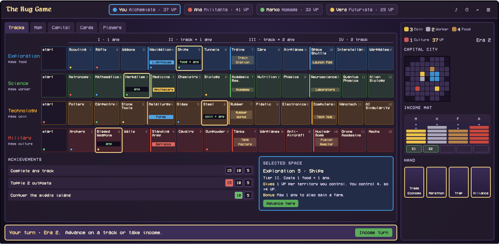
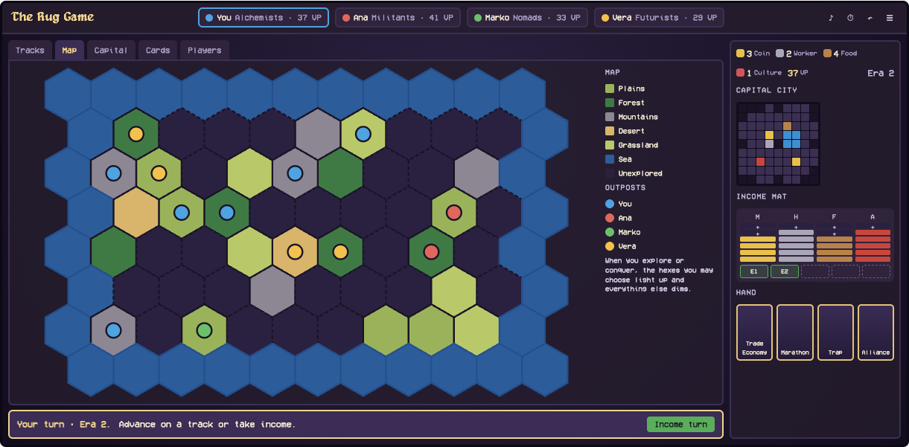
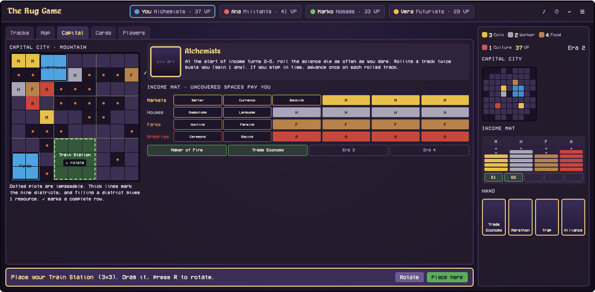
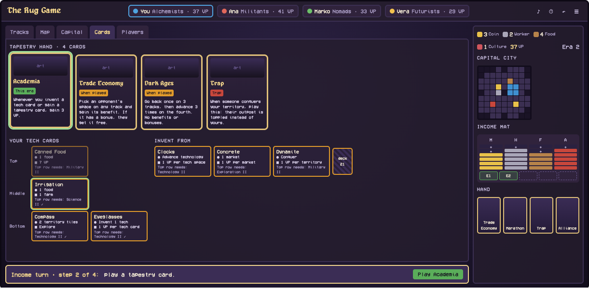
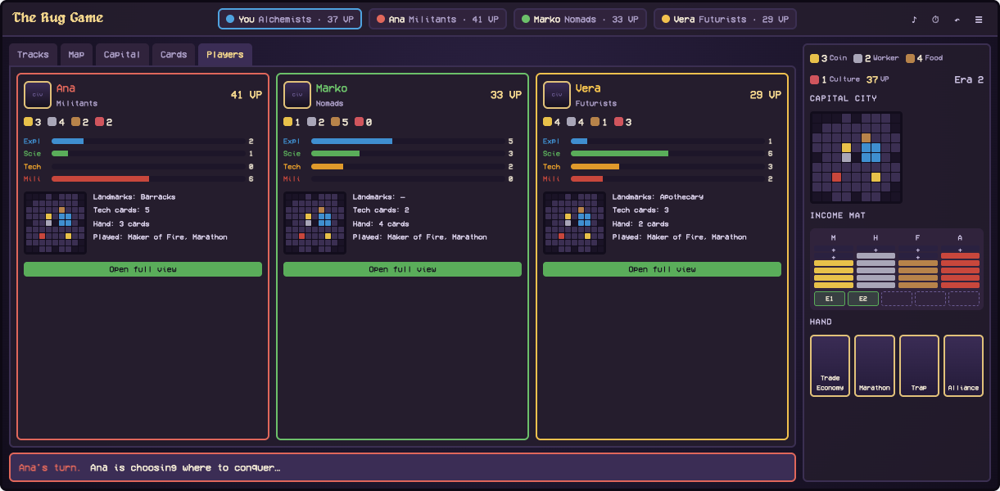

# Interface reference

These are the approved interface designs for The Rug Game. Build the game screens to match them.

The colours and boxes are placeholders. The final artwork follows art style C (see the design document).

## Main game screen (desktop)

Approved by the owner on 2026-10-20. It is layout B from the brainstorm, with the "Your next moves" list removed so the tracks get the full width.

- Open `main-screen.html` in a browser to see every tab at full size.
- Regenerate it with `node mockups/gen-tabs.mjs main-screen.html --standalone`.

### Structure

| Area | Contents |
|---|---|
| Header | Title; one chip per player with colour, civilization and VP (your chip is outlined); controls for sound, timer, undo and the menu |
| Centre | Tabbed view: **Tracks · Map · Capital · Cards · Players** |
| Decision bar | Under the centre view. It always says what is happening and holds the buttons for the current choice |
| Right panel | Your resources, VP and era; small versions of your capital city and income mat; your hand |

### Tabs

**Tracks** is the default view on your turn.

- One row per track, with the arts track as a fifth row when that expansion is on.
- Tier costs run across the top. Every space shows its name and every player's token.
- Landmarks show their name, in gold while still free and in the owner's colour once taken.
- **Your next space** on each track has a gold outline and its cost inside it. The cost is green when you can afford it. This replaces the removed "next moves" list.
- Clicking a space opens **Selected space**: tier, cost, what it gives you right now (for example "you control 4, so +4 VP"), the optional bonus, and **Advance here**.
- The achievements are below the tracks.

**Map**

- The full-width hex map with a legend for terrain and outposts.
- When you explore or conquer, the hexes you may choose light up and the rest dims.

**Capital**, shown here placing a landmark.

- A large 9×9 city with the districts and impassable plots marked. ✓ marks a completed row or column.
- A gained building or landmark follows the pointer as a green ghost. Rotate it with the button or R, then place it.
- Your civilization's ability is beside the city.
- The full income mat shows every innovation by name, with uncovered spaces open and covered ones showing the building. The era slots for played tapestry cards are underneath.

**Cards**, shown during an income turn.

- Your tapestry hand, large, with each card's full text and its timing (when played, this era, or trap).
- Your tech cards in their three rows. A green outline means a card is ready to upgrade.
- The three face-up tech cards you could invent, and the deck.

**Players**, shown while someone else plays.

- One card per opponent: VP, resources, track progress, a small city, landmarks, tech and hand counts, and played tapestry cards.
- **Open full view** shows that player's whole city and mats.

### Behaviour

- **Automatic tab switching.** When a choice needs a particular view, the centre switches to it by itself: Map for exploring or conquering, Capital for placing a building or landmark, Cards for playing a tapestry card or upgrading a tech card. Players can still open any tab themselves.
- **Decision bar.** On your turn it names the step, for example "Income turn · step 2 of 4: play a tapestry card", with the matching buttons. On someone else's turn it says what they are doing, for example "Ana is choosing where to conquer…", in their colour.
- The information on screen is only what the rules make public. Opponents' hands appear as counts only.

## Still to design

1. The phone layout.
2. The landing page, the new-table setup (mode, versions, expansions, solo difficulty, timer, undo) and the lobby.
3. The details of every kind of decision prompt.
4. The income-turn sequence.
5. The end-of-game results.
